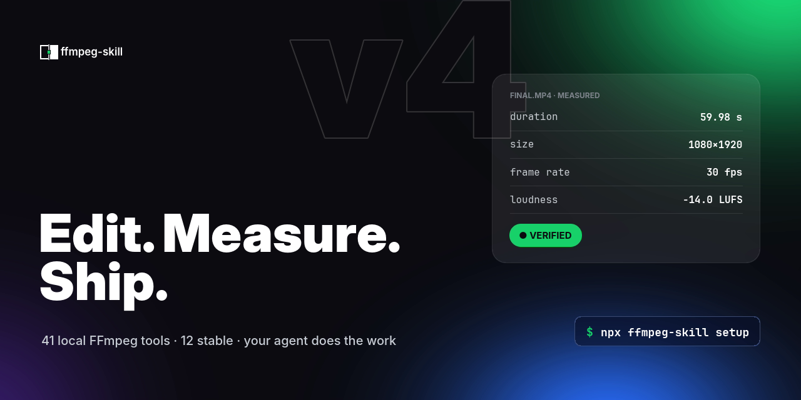
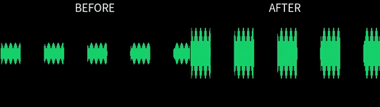
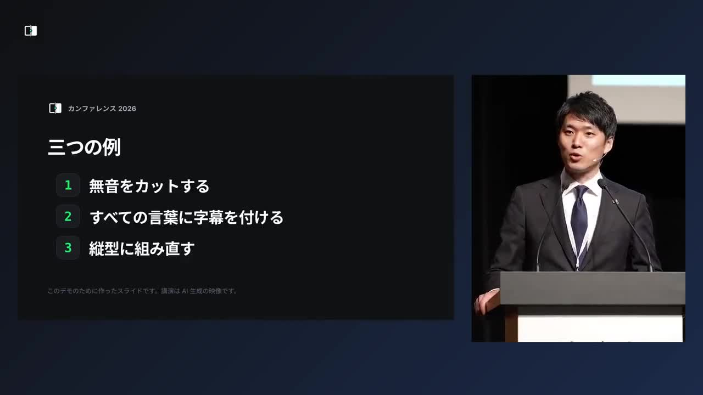
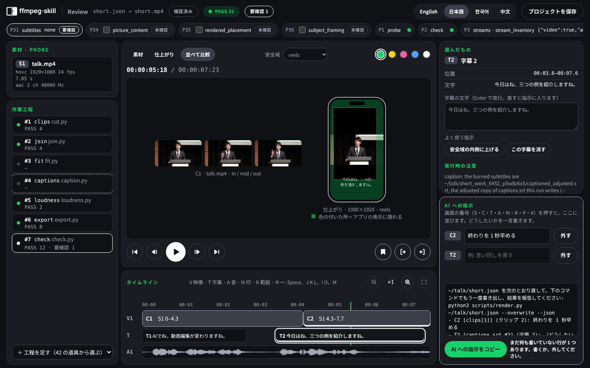
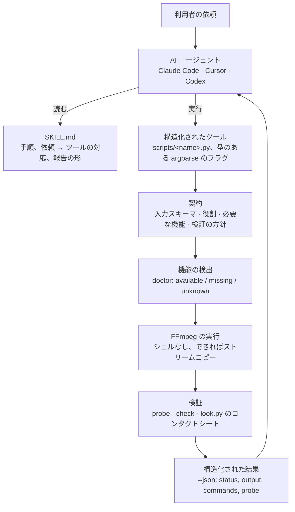
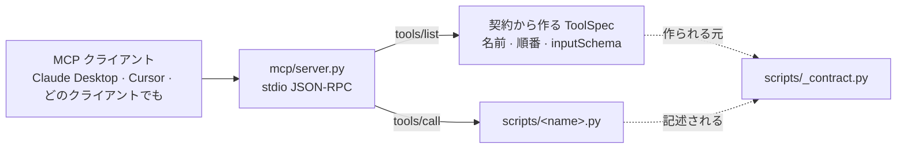

<p align="center">
  <picture>
    <source media="(prefers-color-scheme: dark)" srcset="brand/logo/ffmpeg-skill-horizontal-on-dark.svg">
    
  </picture>
</p>

<p align="center"><b>コーディング AI に、動画編集ソフトを。</b><br>
Claude Code、Cursor、Codex など MCP クライアントが、手元の FFmpeg で映像を編集し、できたファイルを自分で確かめます。<br>
クラウド不要 · API キー不要 · Python の標準ライブラリだけ<br>
<a href="SECURITY.md#what-you-install-and-what-it-touches">何がインストールされ、何に触れるか</a></p>

<p align="center">
  <a href="https://kajisho5.github.io/ffmpeg-skill/?lang=ja"><b>ウェブサイト</b></a> ·
  <a href="#quick-start"><b>クイックスタート</b></a> ·
  <a href="docs/use-cases/README.md"><b>使い方の例</b></a> ·
  <a href="docs/demos.md">デモ</a> ·
  <a href="#tools">ツール</a> ·
  <a href="#mcp">MCP</a> ·
  <a href="https://www.npmjs.com/package/ffmpeg-skill">npm</a>
</p>

<p align="center">
  <a href="https://github.com/kajisho5/ffmpeg-skill/actions/workflows/ci.yml"></a>
  <a href="https://scorecard.dev/viewer/?uri=github.com/kajisho5/ffmpeg-skill"></a>
  <a href="https://www.npmjs.com/package/ffmpeg-skill"></a>
  <a href="https://www.npmjs.com/package/ffmpeg-skill"></a>
  <a href="#ffmpeg-compatibility"></a>
  <a href="LICENSE"></a>
  <a href="https://github.com/sponsors/kajisho5"></a>
</p>

<p align="center">
  <a href="https://kajisho5.github.io/ffmpeg-skill/?lang=ja"></a>
</p>

<p align="center">
  <a href="#quick-start"></a>
  &nbsp;
  <a href="https://kajisho5.github.io/ffmpeg-skill/?lang=ja#showcase"></a>
</p>

<p align="center"><a href="README.md">English</a> · <b>日本語</b> · <a href="https://kajisho5.github.io/ffmpeg-skill/?lang=ja">日本語（サイト）</a></p>

<p align="center"><b>使い方の例（頼み方から確認まで、英語）:</b> <a href="docs/use-cases/vertical-short.md">字幕つきの縦型ショート</a> · <a href="docs/use-cases/audiogram.md">ポッドキャストをオーディオグラムに</a> · <a href="docs/use-cases/phone-clip.md">スマホの動画を整える</a> · <a href="docs/use-cases/cut-down.md">長い収録を短く詰める</a> · <a href="docs/use-cases/platforms.md">1 本のマスターを各プラットフォームへ</a> · <a href="docs/use-cases/two-cameras.md">2 台のカメラで撮った講演</a></p>

この README は [README.md](README.md)（英語）の日本語訳です。見出し、コマンド、ツールの数は英語版とテストで照合しています（`tests/test_contract.py`）。食い違いがあれば英語版が正です。開発者向けの「Development」の節は英語版だけにあります。

```bash
npx ffmpeg-skill
```

<table>
  <tr>
    <td width="50%"><br><sub><code>caption.py --animate pop --karaoke</code></sub></td>
    <td width="50%"><br><sub><code>fit.py --aspect 9:16 --fit crop</code></sub></td>
  </tr>
  <tr>
    <td width="50%"><br><sub><code>silence.py --threshold -35</code></sub></td>
    <td width="50%"><br><sub><code>loudness.py -I -14 --tp -1</code></sub></td>
  </tr>
</table>

<p align="center">
  <a href="https://kajisho5.github.io/ffmpeg-skill/?lang=ja#showcase"></a><br>
  <sub>頼むだけで編集した 12 本のクリップ: 色、スローモーションと縦型への組み直し、スライドを並べた講演とそこから作った字幕つきショート、間の削除、グリーンバックの合成、水平線の補正、スマホで撮った 3 本（手ぶれ補正、暗い夜景を明るくしてノイズ除去、60 fps をスローに）。<a href="https://kajisho5.github.io/ffmpeg-skill/?lang=ja#showcase">見る</a>（英語と日本語）· <a href="docs/showcase.md">頼んだ内容と実際のコマンド</a>。9 本は Google Veo による AI 生成、3 本はスマホで撮ったものです。</sub>
</p>

<a id="review-page"></a>

### レビューページ

編集のあと、エージェントにレビューページを頼むか（「レビューページを見せて」）、自分で `npx ffmpeg-skill review project.json --result run.json` を実行します（チェックアウトからなら `python3 scripts/_review.py`）。ローカルの HTML ファイルが 1 つできます。素材、各手順とその検査、プラットフォームのセーフエリアを重ねたスマホ枠の中の仕上がり、タイムラインが並びます。クリップや字幕の番号を押し、直したいことを書くと、エージェントへの指示文ができるので、それをコピーしてエージェントに戻します。何もアップロードされません。ページは英語、日本語、韓国語、中国語に対応しています。

<p align="center">
  <a href="https://kajisho5.github.io/ffmpeg-skill/?lang=ja#review"></a><br>
  <sub>上の講演を縦型ショートにしたもの（AI 生成の映像）をレビューページで開いたところ。</sub>
</p>

左半分が入力、右半分がコマンドの出力です。**[すべてのビフォー・アフターのデモと、それぞれの実際のコマンド →](docs/demos.md)**。どれも `python3 demos/build.py` で作っているので、すべてのフレームを自分で作り直せます。映像は [demos/footage/](demos/footage/README.md) のもので、Google Veo による AI 生成のクリップ（人物も場所も実在しません）と、スマホで撮った数本です。音は合成したもので、いくつかのデモ（HDR10、パノラマ）は合成した映像を使っています。

`ffmpeg-skill` は、Claude Code、Cursor、Codex など `SKILL.md` を読むエージェントのための [Agent Skill](https://docs.anthropic.com/en/docs/agents-and-tools/agent-skills) です。エージェントに決まった手順（調べる → できるだけ劣化なしで編集する → 検査する → 確かめる）を教え、実際の作業を `ffmpeg` / `ffprobe` で行う **42 個のツール** を同梱しています。カット、結合、無音の削除、尺と縦横比の調整、字幕とカラオケ、重ね合わせとモーショングラフィックス、HDR → SDR と LUT、音声のクリーンアップと型つきのダイナミクス処理、ズレ補正つきの同期、マルチカム、ラウドネス、納品チェック、編集全体をプロジェクトとして書き出す処理、フォルダの一括処理です。どのツールも MCP のツールとして呼べます（クライアントに渡す情報を小さくするため、`tools/list` はふだんコアの 12 個だけを示し、`FFMPEG_SKILL_MCP_FULL=1` で 42 個すべてを示します。どちらでも、すべてのツールが `tools/call` で名前を指定して呼べます）。全体は機械が読める契約で記述されています。

`ffmpeg` と `python3` が PATH にあれば動きます。オフラインで、アップロードしたくない映像にも使えます。

- **元のファイルを守ります。** 入力として宣言したファイルと同じ出力先は拒否します。既存の出力を置き換えるには `--overwrite` が必要です。`batch --watch` のジョブは、前回届けたファイルが変わっていなければ置き換えることがあります。ドライランのコマンドにある `-y` が効くのは、ツールが出力先を確かめたあとだけです。
- **型のあるツールを呼びます。** エージェントは `--aspect 9:16` や `--fit pad` のような名前つきのオプションを渡します。FFmpeg のコマンドとフィルターグラフはツールが組み立てます。
- **編集を確かめます。** ツールは素材と書き出したファイルの両方を調べるので、エージェントは成功を報告する前に、実際の長さ、フレームサイズ、音声を確かめられます。

> **SPEC**（Self-Producing Execution Contract）: 各ツールの `input_schema`、つまり契約と MCP の
> ツール定義のうち CLI のフラグと 1 対 1 で一致していなければならない部分は、コードの横で手書きしません。
> CLI をすでに定義している `argparse` のパーサーから実行時に作られ、少しでもずれると CI が失敗します。
> → [詳しい説明](#what-is-spec)

---

<a id="standalone-and-in-an-ecosystem"></a>

## 単体で、そしてエコシステムの中で

**単体では**、手元で動く FFmpeg のエンジンです。調べる → 編集する → 確かめる、`npx ffmpeg-skill` だけで、ほかには何もいりません。API キーもアカウントも、ほかのリポジトリも不要です。この節の前後に書いてあることはすべて単体のツールの説明で、この節の残りを読まなくても何も変わりません。

**[kajisho5](https://github.com/kajisho5) の動画制作エコシステムの中では**、このリポジトリは「手」です。ファイルを切り、測り、書き出し、結果を構造化された JSON で返します。どこを切るか、納品物を承認してよいか、どの場面が見どころか、字幕に何と書くかは決めません（利用者の字幕の文は書かれたとおりに焼き込み、収まるように書き換えることはしません）。それはこのエンジンの前にいる「頭脳」の仕事で、エンジンの中にはありません。

| やりたいこと | 使うもの |
|---|---|
| ファイルを今すぐ切る、つなぐ、測る、書き出す | **このリポジトリ**（`ffmpeg-skill`）、単体で |
| カット点を決める、納品物を承認する、編集全体を計画する | [`video-production-agent`](https://github.com/kajisho5/video-production-agent) / [`AI-video-production-OS`](https://github.com/kajisho5/AI-video-production-OS) |
| 生の `ffmpeg` を書かずに、ワークスペース全体で型のある編集グラフを組む | [`video-editing-skill`](https://github.com/kajisho5/video-editing-skill) / [`audio-production-skill`](https://github.com/kajisho5/audio-production-skill) |
| 実際の収録に Remotion のモーショングラフィックス（アニメーション字幕、無音のジャンプカット、音のピークに合わせた動き）を載せる | [`remotion-ffmpeg-skill`](https://github.com/kajisho5/remotion-ffmpeg-skill): そのコンポジションは、長さ、fps、フレーム、無音、シーンの切れ目、音のピーク、ビートをこのリポジトリの `probe.py`、`silence.py`、`scenes.py` から受け取ります。レンダリング結果を `check.py` と `look.py` で確かめ、グラフィックスのレイヤーを `overlay.py` で合成し（`--sparse` モードでは `--place`）、`render.py --template` で書き出します |

エコシステムのほかのリポジトリ（[`media-analysis-skill`](https://github.com/kajisho5/media-analysis-skill)、[`transcription-skill`](https://github.com/kajisho5/transcription-skill)、[`subtitle-skill`](https://github.com/kajisho5/subtitle-skill)、[`thumbnail-skill`](https://github.com/kajisho5/thumbnail-skill)、[`color-grading-skill`](https://github.com/kajisho5/color-grading-skill)、[`motion-graphics-skill`](https://github.com/kajisho5/motion-graphics-skill)、[`qc-skill`](https://github.com/kajisho5/qc-skill)）は、どのエージェントフレームワークとも同じように、このリポジトリの `contract --json`、各ツールの `--json` 出力、`doctor` を読みます。このリポジトリからそれらを呼ぶことはありません。依存は一方向です。

---

**目次**
[単体で、そしてエコシステムの中で](#standalone-and-in-an-ecosystem) · [なぜ](#why) · [クイックスタート](#quick-start) · [しくみ](#how-it-works) · [設計の原則](#design-principles) · [ツール](#tools) · [音声](#audio-is-a-first-class-input) · [エージェントのために](#built-for-agents) · [FAQ](#faq) · [FFmpeg との互換性](#ffmpeg-compatibility) · [実際の映像でのテスト](#tested-on-real-footage) · [インストール](#install) · [動作環境](#requirements) · [Development（英語）](README.md#development) · [ドキュメント](#docs)

---

<a id="why"></a>

## なぜ

「FFmpeg を知っている」エージェントでも推測はします。フレームレートを決めつけ、コンテナに入らないコーデックを選び、ストリームコピーで済むファイルを再エンコードし、結果を開かずに「できました」と報告します。このスキルは推測をなくします。

- **まず実際のファイルを見る。** どの作業も `probe.py` から始めます。エージェントはファイル名ではなく、測った長さ、fps、解像度、色、音声のレイアウトから判断します。
- **シェルの文字列ではなく、構造化されたツール。** どの操作も型のある引数を持つスクリプトです。シェルを通るものはなく、呼び出し側からフィルターグラフは受け取りません。
- **エージェントが読める契約。** `contract --json` は、ツールごとに、何を受け取り、何を書き出し、どの FFmpeg の部品が必要で、結果をどう確かめるかを記述します。MCP の面はそこから作られます。
- **実行のあとに確かめる。** 結果を調べ、出す先の仕様と照らし合わせ、映像が変わったときはコンタクトシートとして目で見ます。
- **ローカルが基本。** クラウドも API キーも Python の依存パッケージもありません。音声認識エンジン（Parakeet か whisper）が入っていれば、手元での文字起こしを使いますが、必須ではありません。使うのは `caption.py --transcribe` と、1.17 からの `silence.py --transcribe`（`--filler` と一緒に、または 3.6 から `--sentence-min-silence` / `--sentence-margin-tail` と一緒に）です。どちらも手元の文字起こしを代わりに受け取れ、エンジンが無ければ推測せずにインストール方法を示して断ります。どちらも `--engine` と `--model` を受け取り、`FFMPEG_SKILL_ASR_ENGINE` と `FFMPEG_SKILL_ASR_MODEL` でこのマシンの既定を決められます（たとえば whisper.cpp のそのモデルが入っていれば `large-v3-turbo`。どちらも無ければ auto と `base`）。エンジンはこのマシンで動き、音声はアップロードされません。parakeet-mlx、faster-whisper、openai-whisper は初回の実行時にモデルの重みをダウンロードします（parakeet-mlx の既定は Hugging Face から）。

<a id="paper"></a>

## 論文

このスキルの背後にある設計の規律、つまり AI エージェントのための操作ごとの検証は、ポジションペーパーにまとめてあります。論文は ffmpeg-skill 自身を、論文が定義する規律に部分的にしか適合していないと評価しています。

Kajiyama, S. (2026). *What Is Verification-Driven Coding? — A Discipline for Not Trusting Generation.* Zenodo. https://doi.org/10.5281/zenodo.23720216

<a id="quick-start"></a>

## クイックスタート

下の手順 0 から 2 は、1 つのコマンドでできます。`npx ffmpeg-skill setup` は、このマシンで見つかったすべてのエージェントにスキルを入れ（`~/.claude`、`~/.cursor`、`~/.codex` または `~/.agents`。どれも無ければ Claude Code）、`ffmpeg` が動かなければ FFmpeg を入れ（`brew install ffmpeg-full`、`winget install --id Gyan.FFmpeg -e` または `sudo apt-get install -y ffmpeg`。実行する前に表示します。`--no-ffmpeg` ならパッケージマネージャーは一切動かしません）、最後に `doctor` を実行してその終了コードを返します。この 3 つのパッケージマネージャーのどれも無いシステムでは、スキルを入れ、FFmpeg がまだ無いと伝え、0 以外で終わります。Node 16 以上と Python 3.10 以上が必要で、どちらもインストールはしません。

```bash
npx ffmpeg-skill setup
```

同じ手順を 1 つずつ行うと:

```bash
# 0. FFmpeg 本体を一度だけ（Ubuntu/Debian の例。macOS と Windows は下の「インストール」の表に）
sudo apt install ffmpeg

# 1. Claude Code にスキルを入れる（Cursor: --cursor、Codex: --codex、3 つすべて: --all）
npx ffmpeg-skill

# 2. マシンを点検する: ffmpeg、ffprobe、ツールが必要とする FFmpeg のすべての部品
npx ffmpeg-skill doctor

# 3. （エージェントフレームワーク向け）機械が読める契約を読む
npx ffmpeg-skill contract --json | head -40
```

音声からの字幕（`caption.py --transcribe`）には、別に入れる音声認識エンジンが 1 つ必要です。いちばん簡単なのは `pip install faster-whisper` です。初回の実行でモデルをダウンロードし、音声はマシンの外に出ません。エンジンが無くてもほかはすべて動き、`doctor` はエンジンを「無くてもよいが無い」ものとして示し、`--transcribe` は対応する各エンジンのインストール方法を示して断ります。

インストール済みなら、`npx ffmpeg-skill` をもう一度実行すると `~/.claude/skills/ffmpeg-skill` が新しくなります。コピーは自動では更新されません。

`doctor` 全体の `ok` と、ツールごとの `usable` は別の合図です。`ok` は、*どれかの* ツールが必要とするものが 1 つでも無ければ false になります。つまり、フィルターが 1 つ無いだけで（`subtitles` の無い素の Homebrew の `ffmpeg`、libvidstab の無いビルドなど）、ほとんどのツールは動くのに false になります。ツールごとの答えは `ok` だけでなく `doctor --json` の `tools` を見てください。

あとはエージェントに話しかけます。

> 「`interview.mp4` の 0:45–1:20 と 5:00–5:25 を残して、60 秒のリールにして」

エージェントは `probe.py`、`cut.py --segments 0:45-1:20,5:00-5:25 --accurate`、`fit.py --aspect 9:16 --fit crop`、`export.py --preset reels`、`check.py --platform reels`、`look.py` を実行し、見たコンタクトシートとともに「final.mp4: 60.00 秒、1080×1920、30 fps、AAC ステレオ」と報告します。

<a id="deliver-to-a-platform"></a>

### プラットフォームへ届ける

届け先ごとに 1 つのコマンドで、アプリ自身の UI も考えに入れます。

```bash
python3 $S/render.py talk.mp4 --template tiktok --cues cues.txt
```

これは同梱の `templates/tiktok.json` を埋めます。9:16 のクロップ、TikTok の説明欄より *上* で、いいねの列にかからない位置に 1 語ずつ出る字幕、−14 LUFS、`tiktok` の書き出しプリセット、書き出したファイルへの `check.py --platform tiktok` です。字幕の大きさは納品の表から来るので、1.17.1 からは埋めたプロジェクトに `"fit_size": "on"` も書かれます。誰も指定していない大きさなら、文を 2 つの字幕に分けるのではなく、字幕に収まるまで小さくします。テンプレートが自分の `fit_size` を書いている場合と、`--brand` が字幕の大きさを書いている場合はそちらが優先され、`"fit_size": "off"` のプロジェクトは 1.17.0 と同じ字幕を描きます。テンプレートは `tiktok`、`reels`、`shorts`、`youtube-shorts`、`youtube`、`x`、`linkedin`、`facebook`、`podcast`、`audiogram` の分があります。`--template all`（またはカンマ区切りのリスト）は、同じ編集から 7 つの動画の届け先（`tiktok`、`reels`、`shorts`、`youtube`、`x`、`linkedin`、`facebook`）を書き出し、それぞれ何ができたかの表を `<name>_pack.md` に書きます。`-o` で指定しなければファイルは入力の隣にでき、`--dry-run` は結果の代わりに予定しているすべてのコマンドを示します。`render.py --list-templates` は、テンプレートをフレーム、制限、セーフゾーンとともに表示します。プラットフォーム名を書くところではどこでも別名が使えます（`youtube-shorts` = `shorts`、`ig` = `reels`、`twitter` = `x`、`fb` = `facebook`）。

ツールは単独でも、どのシェルからでも使えます。

```bash
S=~/.claude/skills/ffmpeg-skill/scripts
python3 $S/probe.py input.mp4 --compact
python3 $S/fit.py input.mp4 --duration 60 --method trim --aspect 9:16 --dry-run    # 尺の切り詰めと縦型化を計画する
python3 $S/export.py input.mp4 --preset reels --json                 # 出力を調べた結果つきの構造化された結果
```

Windows の Git Bash では、Python を Microsoft Store から入れた場合にだけ `python3` が PATH にあります。python.org から入れた場合は `python`（または `py` ランチャー）です。「command not found」と出たら、上の `python3` を `python` に置き換えてください。`bin/install.js` と `doctor`/`contract` はこれを自動で扱うので、手で書く必要があるのは上のスクリプトの例だけです。

ほかの頼み方とその裏のコマンド: [examples/README.md](examples/README.md)。生成した映像ですべてを通しで動かすには `npm run demo`（[docs/demos.md](docs/demos.md) のギャラリー）。頼み方から確認までを 1 件ずつ追った例: [docs/use-cases/](docs/use-cases/README.md)（英語）。

<a id="how-it-works"></a>

## しくみ



MCP では、同じツールに、自分ではツールの表を持たない通信路を通して届きます。



`tools/list` の名前、順番、`inputSchema` は、起動時に各ツールの argparse のパーサーから変換されます。新しいフラグや新しいスクリプトは `mcp/` を編集しなくても MCP に現れます。テストがスキルをコピーし、スクリプトを足し、消し、書き換えてから `tools/list` を読み直して、それを確かめています。

<a id="design-principles"></a>

## 設計の原則

スキルのファイルがエージェントに与え、コードが守らせる決まりです。

1. **まず調べる。** ファイル名から判断するツールはありません。何かを切る前に、`probe.py` が長さ、fps（可変フレームレートの検出つき）、解像度、回転、ビット深度、Dolby Vision を含む HDR の形式、色のタグ、すべての音声ストリームを測ります。
2. **できるだけ劣化なしで。** `cut.py` と `loudness.py` は、触る必要のないものをストリームコピーします（`join.py` はクロスフェードと、合わないクリップをそろえるために再エンコードします。`--copy --transition none` は、すでに合っているクリップをストリームコピーでつなぎます）。再エンコードは必要なときだけです。フレーム単位で正確なカット、フィルター、形式の変更、許容範囲より遠いキーフレーム。
3. **書き出す前に計画する。** どのツールも `--dry-run`（ffmpeg のコマンドを表示し、何も書かない。`verify` は無視します）、`--plan FILE`（ドライランを、入力の指紋つきの計画として保存し、あとで `render.py FILE` が実行する。入力が変わっていれば断る。`render` と `verify` は受け付けません）、`--json`（出力を調べた結果つきの構造化された結果）、`--fast`（プレビュー品質）、`--progress`（進み具合と残り時間）、`--timeout`（止まった ffmpeg を終了させて報告し、いつまでも待たない。Ctrl-C や SIGTERM も同じく実行中の ffmpeg を止め、途中までの出力を消し、`kind: interrupted` を報告します）、`--overwrite`（既存の出力を置き換える前の明示的な同意）を受け取ります。あるテストは、契約がドライランで ffmpeg を動かさないとしているすべてのツール（`ffmpeg_execution: none` と、測定のフラグを付けない `cut` と `metadata`）を、偽の ffmpeg の後ろで `--dry-run` で動かし、ffmpeg が呼ばれず、ファイルもできなかったことを確かめます。別のテストは、契約が `--dry-run` に対応するとしているすべてのツール（`verify` 以外）を、デコードのたびに記録する ffmpeg の後ろで動かし、ファイルができなかったこと、デコードしたツールがすべて契約で `analysis_only` とされているものだったことを確かめます。
4. **機械が読める契約。** `contract --json` は 42 個のツールすべてを記述します。パーサーから作った入力スキーマ、出力スキーマ、役割、常に必要な FFmpeg の機能と条件つきで必要な機能、ドライランへの対応、あとで実行する検証のツール、目での確認が必要か、`mutates_input: false`。`provides` は、[`kajisho5/AI-video-production-OS`](https://github.com/kajisho5/AI-video-production-OS) の `CapabilityContract.provides` のために、42 個すべてをリポジトリをまたぐ Capability の id（`ffmpeg-skill.cut`、`ffmpeg-skill.loudness` など）で並べます。`docs/contract.md` を見てください。
5. **契約から作る MCP。** `mcp/server.py` は `tools/list` を契約から作ります。ツールの名前、順番、`inputSchema` がスクリプトとずれることはなく、テストが両者をバイト単位で同じに保ちます。
6. **機能の検出。** `doctor` は `ffmpeg -encoders / -decoders / -filters / -bsfs` を読み、ツールが必要とする部品（libx264、libass、zscale、loudnorm、xfade など）のどれがこのビルドにあるかを、作業が ffmpeg の中で失敗する前に報告します。
7. **わからないことは、無いことではない。** 一覧が読めないとき（パーサーの知らない並び、ffmpeg が 0 以外で終わった）、影響を受ける機能は `unknown` になります。`missing` にはせず、黙って `available` にもしません。入っているフィルターを無いと報告せず、検出の失敗を合格にもしません。
8. **結果を確かめる。** 出力を調べ、映像が変わったとき（字幕、重ね合わせ、クロップ、色、トランジション）はエージェントが `look.py` を実行して PNG を見ます。報告の `Look:` の行がその画像を名指すまで、報告は終わりません。音声だけの作業は `Look: not needed` と書きます。**「見る」のは呼び出したエージェント自身の視覚で、このスキルの機能ではありません。** `look.py` は PNG を描くだけで、このリポジトリのどこにも、顔、商品、被写体、フレームやシーンの「面白いところ」を見つけるものはありません。クロップや縦型化でフレームの特定の部分を残す必要があるとき（`fit.py --fit crop --crop-x/-y`、[ツール](#tools) を参照）、その PNG を見て位置を選ぶのはマルチモーダルなエージェントです。画像を見ない呼び出し側（スクリプトや、シートを見ない CLI の利用者）は、その判断を自分で渡す必要があり、既定は単純な中央のクロップです。同じく、`scenes.py --highlights` はシーンの候補を測った代わりの指標（`--rank-by audio` か `--rank-by duration`）で並べるだけで、内容では決して並べません。シートを見て判断に変えるのはエージェントです。
9. **報告のラベルは 1 つ。** 終わった作業は `Done:`、失敗や断りは `Failed:`、一部だけの結果は `Done:` で、足りない部分を `Notes:` に書きます。`Done (partially):` のような 3 つ目のラベルは使いません。
10. **元のファイルを残す。** 入力を上書きするツールはありません。出力は、指定が無ければ `<input>_<operation>.<ext>` という名前の新しいファイルで、テストが実行後にすべての入力のハッシュを取ります。

<a id="tools"></a>

## ツール

公開ツールは 42 個で、すべて Python 3.10 以上の標準ライブラリだけで書かれ、どれも `--help`、`--dry-run`、`--json`、`--plan FILE`（あとで `render.py` が実行する計画として書いたドライラン）を持ち、失敗すると 0 以外で終わって stderr に理由を書きます。`--json-brief`（1.11.0）は同じ結果の文書を、呼び出し側が使う部分だけに絞って出します。status、output、`verified`、出力を調べた結果の短い `summary`、ツール自身のキー、そしてコマンドの行の代わりにコマンドの数で、バイト数はおよそ 3 分の 1 です。`--json` 自体は変わりません。`export.py`、`render.py`、`batch.py`（プリセットかプロジェクトが決める）以外の再エンコードするツールはすべて `--codec h264|hevc|av1|prores` と `--quality N`（1.8）を受け取り、`export.py` と同じく `--hw`/`--no-hw`（Apple Silicon の Apple VideoToolbox、明示したときだけ。下の `doctor` を参照）も受け取ります。時間を受け取るフラグはすべて、秒、`mm:ss`、`hh:mm:ss.fff`、SMPTE の `hh:mm:ss:ff` を受け付け、`@fps` を付けられます（1.9）。

**Analysis and inspection**（分析と確認）

| ツール | すること |
|---|---|
| `probe.py` | 長さ、fps（+ VFR の検出）、解像度、コーデック、ビット深度、Dolby Vision を含む HDR の形式（`hdr` は本物の PQ/HLG/DV の伝達特性のときだけ、`bt2020_or_hdr` は BT.2020 の SDR でも）、色空間、回転、すべての音声ストリーム。`--analyze` は Log の映像を見分けます |
| `scenes.py` | シーンの切れ目、音のピーク、見どころの候補（`--rank-by audio` は大きい順、`--rank-by duration` は長い順。どちらも代わりの指標で「いちばん良い」ではありません）とシーンごとのシート。`cut.py --segments` 用のカットリスト。`--beats` は音楽のビートの格子（テンポ、ビートの時刻、確からしさ）を測り、`--shots` は測ったオプティカルフローで各ショットを static/pan/motion に分け、`--audio-peaks` は秒ごとの dBFS を並べ、`--speech` は話し声と音楽の比を報告します（分類ではありません） |
| `look.py` | コンタクトシート、1 枚のフレーム、並べての比較を PNG で書き出し、エージェントが作ったものを見られるようにします。`--safe NAME` はプラットフォームの UI が隠す部分に色を付け、`--guides title,action,4:3` は放送のセーフエリアを描きます（PNG の上だけ） |

**Editing**（編集）

| ツール | すること |
|---|---|
| `cut.py` | イン/アウトや複数区間のカット。まず劣化なしの `-c copy`、だめなら再エンコード。`--accurate` で映像はフレーム単位、音声はサンプル単位で正確に切ります。`--smart` は H.264 をフレーム単位で正確に切り、カット点の途中の GOP だけを再エンコードし（素材に合わせ、そのパケットとフレームで確かめます）残りはコピーします。SDR の HEVC の素材は HEVC で再エンコードし（x264 にするなら `--no-keep-hevc`）、`.mp4`/`.mov` 1 本のコピーはエディットリストを残すので、キーフレームがあとにずれない限り映像は `--start` から始まります（ずれたときは `start_snapped` がそう言います。2.x と同じずれた始まりにするなら `--no-edit-list`）。`snapped_segments` はコピーがどこに着地しうるかを、切り出したキーフレームと照らして示します（`copy_drift_large` は `--accurate` を勧めます）。VFR の確かめ方は `--vfr-guard` で選びます（既定は `sampled`）。`precision` を報告します。`--snap beats` はイン/アウト点を測ったビートに動かし、測れる拍が無ければ断ります。`--remove A-B,...` は区間を落として残りを残します |
| `join.py` | xfade のトランジションでクリップをつなぎ、サイズ、fps、サンプルレート、チャンネルのレイアウトをそろえます（いちばん広いクリップのもの、または `--channels`）。音声だけの入力は音声としてつなぎます。`--list parts.txt` は生成した部品（TTS の行など）を読み、まずすべてを確かめます。無い、空、読めない部品は 1 回の断りですべて名指しするか、`--on-missing skip` で飛ばして報告します。`--copy --transition none` はストリームが合うクリップをストリームコピーでつなぎ、あとで測り、合わなければ名指しして断ります。`--transition none --audio-lead S` / `--audio-lag S` は J カット / L カットを作ります（次の音が映像より S 秒早く始まる / 最後の音が映像の切り替わりのあと S 秒続く。同期は保たれます） |
| `silence.py` | 無音（デッドエア）を見つけて取り除きます（ジャンプカット）。話し声の前後に余白を残し（`--margin`、前後に 0.2 秒）、カットリストを表示・書き出すか、素材から出力への時刻の対応を書きます（`--timemap`、JSON か CSV）。すべてのカット点のレベルを報告し、息や語尾にかかりそうなところに警告を出します。`--filler` はフィラー（言いよどみ）も取り除きますが、音声認識エンジンが時刻を付けたところだけです。`--speech-aware` は文の中の息つぎを残し、文の切れ目の間だけを切ります。`--filler` とは同じ `keep_ranges()` で組み合わさります。`--margin-lead` / `--margin-tail` は話し声の前と後に残す量を変え、単語の時刻があれば `--sentence-min-silence` / `--sentence-margin-tail` で、文の終わり（文字起こしの句読点）のあとの間に独自の下限と余白を与えます |
| `fit.py` | 尺（大きな速度変化には方法を選ぶ）、縦横比（パッド、クロップ、ぼかしの塗り）、正確なサイズに合わせます。`picture` は書き出したフレームを測ります。`crop_check` は捨てた部分の動きや細部に印を付け、`--crop-x`/`--crop-y` を提案できます。90/180/270 度の回転、上下左右の反転、固定 fps への変換も。 |
| `crop.py` | 正確なピクセルの矩形でクロップします（`--x --y --width --height`）。自分で計算した縦横比でクロップする `fit.py --fit crop` とは別のものです |
| `cropdetect.py` | すでにある黒い帯（レターボックス/ピラーボックス）を測り、それを取り除く `crop.py` 用の矩形を報告します。分析だけで、ファイルは書きません。`--motion-centre` は代わりに秒ごとの動きの中心を報告します。9:16 への組み直し用で、報告だけです。クロップを選ぶのは呼び出したエージェントで、自動の組み直しはしません |
| `deinterlace.py` | インターレースの素材をデインターレースします（`yadif`）。`--mode frame`/`field`、`--parity` |
| `denoise.py` | 映像のノイズや粒子を減らします（`hqdn3d`）。`--strength low/medium/high` か、空間/時間方向の値を個別に |
| `redact.py` | 正確なピクセルの矩形を、クリップ全体にわたってぼかす、モザイクにする、または（`--mode delogo`）周りから補間して消します。矩形は与えられたものです。顔、ナンバープレート、ロゴを見つけるものはここにはなく、`delogo` は縁を混ぜるもので、インペインティングではありません |
| `sphere.py` | 360 度/全天球の映像から平らな（直線的な）視野を取り出します（`--yaw --pitch --roll --h-fov --v-fov`）。被写体の追跡はなく、与えた向きだけです |
| `straighten.py` | 水平線の補正のために任意の角度で回転します（`--degrees`、`--fit crop/pad`）。`fit.py --rotate` のちょうど 90 度の回転とは別のものです |
| `insert.py` | 静止画を、音の無い、決まった長さの動画クリップ（タイトルカード、エンドスレート）にします。正確なフレームサイズ / fps で、Ken Burns のズーム/パンも付けられます |
| `background.py` | 単色または 2 色のグラデーションのクリップを、正確なサイズと長さで作ります。入力ファイルはいりません。`--transparent` は、グラフィックスを描くための完全に透明なキャンバスを書きます（ProRes 4444、QuickTime Animation、PNG、アルファつきの VP9） |
| `reverse.py` | 逆再生（映像と、`--no-audio` でなければ音声も） |
| `stabilize.py` | 2 パスの手ぶれ補正（`vidstabdetect`/`vidstabtransform`） |
| `sequence.py` | 連番（`frame_%04d.png`）またはグロブに合う静止画を動画にします |
| `waveform.py` | 音声トラックを波形やスペクトルの動画にします。カット時刻の波形の PNG には `--at` を、`--platform`、`--title`、焼き込み字幕つきの動画のオーディオグラムには `--image` を使います |
| `freeze.py` | 1 つのフレームを N 秒止めます（`--at`、`--hold`、`--mode insert/extend`）。エンドカードの静止や、笑いの間に |
| `pad.py` | タイムラインの最初や最後に黒/無音の余白を足します（`--start`、`--end`）。フレームごとに帯を付ける `fit.py --fit pad` とは別のものです |
| `speedramp.py` | `--segment START-END:FACTOR`（繰り返し可）で、クリップのタイムラインに沿っていくつかの一定速度を段階的に切り替えます。クリップ全体を 1 つの速度にする `fit.py` とは別のものです |
| `loop.py` | クリップを `--times` N 回、または目標の `--duration` まで繰り返します。背景のループや、決まった枠の長さを埋めるのに。`--crossfade` はつなぎ目をなめらかにし、`--boomerang` は順再生のあと逆再生します |
| `broll.py` | ある時間だけ A ロールの上に B ロールのクリップを挟み（`--insert B --at T --duration D`、繰り返し可）、また戻ります。既定では A の長さと音声は変わりません |
| `metadata.py` | `TIME TITLE` のテキストファイルからコンテナのチャプターマーカーを、title/artist/comment のタグとともに書きます。すべてのストリームはビット単位でそのままコピーします。`--auto-chapters` は測った間とシーンの切れ目からマーカーを提案し、あとで名前を付け直す前提で `Chapter N` と名付けます |
| `grid.py` | `--cols`x`--rows` 個のクリップを 1 つのグリッドに合成します。既定では各セルをレターボックスにし、ファイル名のラベルを付けます（付けないなら `--label none`） |

**Audio**（音声）

| ツール | すること |
|---|---|
| `audio.py` | 3 段階の強さの声のクリーンアップ（`--voice light\|medium\|strong`）、FFT のノイズ除去、型のあるコンプレッサー / リミッター / ゲート、サイドチェインのダッキングつきの音楽ベッド（`--duck-amount/-threshold/-attack/-release`）、ダッキングしない効果音のベッド（`--effects`）、`--stereo-widen`、フェード、5.1 → ステレオ、トラックの差し替え、取り出し（`-o out.wav`）、`--audio-stream N`、音程を変えないテンポの変更（`--tempo`、0.5–2.0 の atempo の段）、サンプル数で正確な長さ（`--length-samples`）、リサンプリング（`--sample-rate`）、番号で選ぶ 1 チャンネル（`--channel N`）。どれも出力から読み戻して確かめます。`--track FILE`（繰り返し可）と `--track-name` / `--track-lang` は、入力の音と各ファイルの音を、名前と言語のタグつきの別々の音声トラックとして `.mov`、`.mkv`、`.mp4` に書きます。それぞれそのままで、出力から読み戻して確かめます |
| `sync.py` | 2 つの収録のずれを音声の相互相関で求め（1 ms、純粋な Python）、クロックのズレを補正し、そろえた映像か音声を出します（音声どうしだけ。口の動きや顔の検出はしません）。3 台目以降のカメラは追加の `more_sources` の位置引数です（`sync.py REF A B ...`）。`second` の位置引数は名前を変えていません |
| `loudness.py` | 2 パスの EBU R128 `loudnorm` で −14 LUFS / −1 dBTP か任意の目標に（範囲は `--lra`）。映像はストリームコピーします。書き出したファイルをもう一度測り、`--tp` を満たすまで再エンコードします（非可逆のエンコーダーは超えることがあるため）。`--measure-only`。`--versions streaming,ebu-r128,broadcast-jp`（または `LUFS/TP` の組）は、1 本のマスターから目標ごとに 1 ファイルを書き、それぞれ書いたあとに測って `versions` に並べます（`output` は null）。`verified` は、すべての版がそれぞれの目標を満たしたときだけです |

**Picture**（映像）

| ツール | すること |
|---|---|
| `caption.py` | フォント、サイズ、色、縁取り、位置を指定して SRT/ASS を焼き込みます。時刻つきのプレーンテキストから SRT を作ります。セーフエリアに収まるように折り返します。`--platform` を付けると届け先自身の左右のセーフゾーンに合わせ、1.17.2 からは焼き込む ASS の左右の余白もそれになります。句を意識した改行（`--wrap phrase\|measured`）と `--max-lines`/`--min-duration`/`--offset`。`--mode mux` は `--srt file:lang` を繰り返し受け取り、言語のタグつきで切り替えられる複数のトラックを 1 ファイルに入れます。ラテン文字以外は文字体系でフォントを選びます（`--lang`）。話し声の大きさか実際の単語の時刻に合わせた、アニメーションと 1 語ずつのカラオケ。`--fit-size` は、文を分ける代わりに、字幕が `--max-lines` に収まるまでサイズを小さくします（1.17.1 から、サイズがプラットフォームの表から来る納品テンプレートの経路では既定で有効）。字幕を渡されたとおりに焼き込んだときは `caption text unchanged` と言います。手元での文字起こしは任意です |
| `overlay.py` | ロゴ、ウォーターマーク、タイトルを、位置、時間の範囲、不透明度、フェードを指定して重ねます。`--platform NAME` はその届け先の UI にかからないようにします。`--video` はピクチャーインピクチャー、`--chromakey` はグリーンバックの合成、`--place` はレイヤーの範囲を選んだ時刻に置きます。`--keep-alpha` は透明なキャンバスやアルファつきのクリップに合成し、結果をアルファつきで書きます。アルファつきの VP9 のレイヤーは透明さを保ちます |
| `graphics.py` | ブランドキットから FFmpeg が描く、ロワーサード、タイトルカード、チャプターのチップ、プログレスバー、カウントダウン、コーナーのバグ、SNS のステッカー、冒頭のフックカード、ミームのキャプション。`--platform NAME` はその届け先のセーフゾーンの内側に収めます。`--text-render` は字形の整形が必要な文字を libass に通し、`--emoji-assets` はカラーの絵文字を合成します。`--keep-alpha` はテンプレートを透明なキャンバスに描き、要素ごとのアルファのレイヤーにします |
| `color.py` | HDR10 / HLG / Dolby Vision → SDR BT.709 のトーンマッピング、DV のレイヤーの除去、3D LUT（.cube）、色のタグの書き換え、型のある一次補正（露出/コントラスト/彩度/ガンマ/ホワイトバランス/リフト・ゲイン/レベル/カーブ）。`--keep-alpha` はアルファつきのクリップをグレーディングしてアルファを残し、フレームごとに確かめます。`--legalize bt709\|ebu-r103`: 4:2:0 への変換のあとで法定範囲に収め、書き出したファイルで測ります |

**Delivery**（納品）

| ツール | すること |
|---|---|
| `export.py` | プリセット `youtube`、`youtube4k`、`reels`、`tiktok`、`shorts`、`linkedin`、`facebook`、`x`、`youtube-hdr`（HEVC Main10、素材の HDR のタグを残す）、`youtube-av1`、`prores`、`dnxhr-lb`/`sq`/`hq`/`hqx`/`444`、アルファつきのマスター `prores4444`/`prores4444xq`/`qtrle`/`vp9-alpha`/`hap-alpha`（アルファを読み戻す）、`key-fill`（スイッチャー用のフィルとキーの組）、`h265`、`gif`、`copy`。HDR を運ぶものと編集用のマスター（`prores`、`dnxhr-*`: 素材のタグを残し、コーデック、プロファイル、ピクセル形式を読み戻す）以外はすべて BT.709 のタグを付けます（BT.601 の行列や RGB の素材は、ラベルの付け替えではなく BT.709 に変換します）。`--normalize` は同じ呼び出しの中でプラットフォームのラウドネスを満たします（`render.py` はプラットフォームのプリセットで既定で有効にします）。`--max-mb MB` は 2 パスのエンコードでファイルをサイズの上限に収め、測ります。`--preset copy --repair` は壊れたファイルを入れ直し（タイムスタンプを作り直し、壊れたパケットを落とす）、前後のエラーの数を数えます |
| `proxy.py` | 後段の AI による分析、プレビュー、編集の判断のための、小さく低ビットレートのプロキシ。`--width`/`--scale` で縮小、プロキシ品質の `--quality`（既定 30）、`--fps`、`--no-audio`。納品用のプリセットではありません |
| `check.py` | YouTube、Shorts、Reels、TikTok、X、LinkedIn、Facebook、放送、ポッドキャストの仕様に対して PASS / WARN / FAIL を出します。書き出しのプリセットやテンプレートと同じ納品の表を使います（ポッドキャストはチャプターマーカーとチャンネル数も報告します）。失敗ごとに直し方を示し、行ごとに `format` / `judgement` の種類を付けます。表のアップロード上限を超える長さやファイルサイズは `basis: guidance` の印つきの WARN です（プラットフォームは上限を変えるので、最新の値はアップロードする人が確かめます）。`--max-duration` / `--max-mb` は呼び出し側自身の上限で、`--platform` を指定したときは FAIL にします（指定しなければ、長さの超過はほかの判断の行と同じく WARN）。`--content` は、黒いフレーム、止まったフレーム、無音、短い音切れ、1 フレームだけの閃光、平らな最初のフレームの行を足します。`--compare REF` は基準との SSIM/PSNR を測り、`--expect-changed SPAN\|none` を付けると、呼び出し側が宣言した区間の外で映像が変わっていたら失敗にします。`--levels bt709\|ebu-r103` は放送の法定範囲の外にある輝度と色差のサンプルを、クリップごと、区間ごとに数え、Y/U/V の最小/最大を出します。`--expect-identity` は、そのファイルが実行で書いたと報告したもの（`output_identity`）かを確かめます |
| `report.py` | 1 ファイルの HTML の納品レポート。前後のシート、メディアの事実、ラウドネス、適合性、実行したコマンド。`--pack` は SNS パックの表を描きます |

**Orchestration**（まとめて動かす）

| ツール | すること |
|---|---|
| `render.py` | 宣言的な `project.json`（クリップ、トランジション、字幕、SNS のステッカー/フック/ミームのグラフィックスや、最終のフレームに合わせたピクチャーインピクチャーやクロマキーの `video` レイヤーを含む重ね合わせ、音楽とステムのレベル、ラウドネス、書き出し、チャプターマーカー、検査）から編集全体を書き出します。`--init`、`--dry-run`、`--stop-after`、`--cache DIR`/`--from STAGE`（変わっていない段を使い回す）。字幕のブロックは大きさの調整の方針（`fit_size`、`min_size`、`fit_size_scope`）を受け取り、実行は字幕の段の数を `caption` として報告します。`--template NAME INPUT` は同梱の納品テンプレートを書き出します（`--template all` は SNS パック全体とその表を書きます）。`--export-timeline edit.fcpxml\|.edl\|.otio`（2.1）は書き出す代わりに、カットを Final Cut、DaVinci Resolve、Premiere 用の編集タイムラインとして書きます。クリップ、速度、ディゾルブ、音楽のベッド、チャプターマーカーが引き継がれ、残ったものは `not_exported` が名指しします |
| `batch.py` | 手順のレシピかプロジェクトを、内容のハッシュによるキャッシュつきでフォルダに適用します。`--watch`。`--jobs N` は共通の `--timeout` 1 つの下で複数のファイルを同時に処理します。書き出す手順は `{out}` か自分の `-o`/`--output` を名指しする必要があります。代わりに既定の出力に書く手順は断ります（`step_writes_without_out`） |
| `multicam.py` | 何台のカメラや録音機でも音声でそろえ（ズレ補正つき）、切り替えのリストに沿ってカメラを切り替えます。`--switch energy` は手で作ったリストの代わりに、その瞬間いちばん音の大きいカメラに自動で切り替えます（誰が話しているかの代わりに音のレベルを使います。話者の識別は無いので、話す人それぞれが自分のカメラのマイクに入っている必要があります）。`--min-shot`（ショットの最短の長さ）と `--edl`（CMX の EDL ではなく単純な START-END のカットリストを書きます。Premiere/Resolve 用には `--write-project` のあと `render.py --export-timeline`） |
| `verify.py` | 実機のファイルでツール一式を動かし、手順ごとに PASS / FAIL を報告します |

ツールではないものの、面の一部: `mcp/server.py`（MCP の通信路）と `scripts/_contract.py`（`contract --json`、`doctor`）。全ツールのフラグごとの説明: [references/scripts.md](references/scripts.md)。

<a id="audio-is-a-first-class-input"></a>

## 音声も一人前の入力

WAV、FLAC、MP3、M4A/AAC、OGG、Opus、Matroska の音声（MKA）は、動画と同じコマンドで `probe`、`cut`、`join`、`silence`、`loudness`、`audio`、`sync`、`check --platform podcast` を通ります。エンコードするとき、`.wav` は PCM、`.aif`/`.aiff` と `.caf` は 16 ビットの PCM、`.flac` と `.mka` は FLAC、`.mp3` は MP3、`.m4a` は AAC を書きます。`.mka` へのカットでは、ストリームコピーは元の音声コーデックを残し、`--accurate` は FLAC を書きます。映像つきの Matroska のカットには `.mkv` を使います。`.wma` は `cut.py` と `metadata.py` で WMA の音声のストリームコピーに対応しています。

- **取り出し。** 動画の入力に音声の拡張子を付けると映像を落とします。`audio.py talk.mp4 -o talk.wav`、またはついでにきれいにするなら `--voice -o talk.m4a`（映像より遅れて始まる音はその位置を保ち、前の部分は無音として書きます）。映像をエンコードするツール（と、映像のある素材に対する `metadata.py`）は音声の拡張子を断ります（`output_extension_audio_only`）。`--audio-stream N` でトラックを選び、`probe` が `audio_streams` に並べます。
- **結合。** `join.py intro.wav episode.m4a outro.wav -o full.flac` はすべてのクリップを 1 つのレートとチャンネルのレイアウトにリサンプリングし、クロスフェードでつなぎます（突き合わせでつなぐなら `--transition none`）。音声と動画の入力を 1 回の結合に混ぜることはできません。
- **サンプル単位で正確な切り出し。** `cut.py talk.wav --start 1.2345 --end 2.3456 --accurate` はサンプル単位で切り、JSON は `precision`（ストリームコピーは `packet`、PCM / FLAC は `sample`、非可逆のエンコーダーが音声をフレームに切り直すときは `codec_frame`、映像は `frame`）と、測った `duration_error_ms` を報告します。`.wav` に圧縮されたパケットが入ることはありません。
- **型のあるダイナミクス。** `audio.py --compress --comp-threshold -20 --comp-ratio 4`、`--limit --limit-ceiling -1`、`--gate --gate-threshold -45`。どのフラグも FFmpeg の `acompressor`、`alimiter`、`agate` の文書化されたオプション 1 つにあたり、ffmpeg を動かす前に範囲を確かめます。呼び出し側からフィルターの文字列は受け取りません。
- **ラウドネス。** ポッドキャストのレベルには `loudness.py talk.wav -I -16 --tp -1.5 -o talk.m4a`。`check.py talk.m4a --platform podcast` は LUFS とトゥルーピークを測り、チャプターマーカーとチャンネル数を報告します。

映像のツール（`fit`、`caption`、`overlay`、`graphics`、`color`、`export`、`look`）は、映像を作り出す代わりに、音声ファイルを「input has no video stream」で断ります。`scenes.py` は音声ファイルを測ります（`audio_only: true`、シーンは 1 つ）。`--beats`、`--audio-peaks`、`--speech`、`--highlights` は音に対して動き、`--sheet` / `--shots` は断ります。

<a id="built-for-agents"></a>

## エージェントのために作られている

<a id="what-is-spec"></a>

### SPEC とは

**SPEC**（Self-Producing Execution Contract）は、このプロジェクトの作者
[kajisho5](https://github.com/kajisho5) が、ツールの層の土台にしている型に付けた名前です。各ツールの
`input_schema`、つまり契約のうち CLI とフラグ単位でぴったり一致していなければならない部分は、コードの横で手書きしません。CLI が動くためにそもそも正しくなければならない唯一のもの、スクリプト自身の `argparse` のパーサーから、実行時に作られます。

具体的には、`scripts/_contract.py` の `_capture_parser()` がすべてのツールのスクリプトを読み込み、その `parse_args()` の呼び出しを横取りして、組み上がった生きたパーサーのオブジェクトを手に入れます。フラグ、型、選択肢、既定値、必須/位置引数、同時に使えないグループ、そのすべてです。`input_schema` はそのオブジェクトからそのまま作られます。（`ToolSpec` の残り、`role`、`capabilities`、`inputs`、`outputs`、`output_schema` は手書きの表 `TOOL_META` から来ます。パーサーが表せる事実ではないからで、パーサーから作られるのは `input_schema` だけです。）

- **契約** の各ツールの `input_schema` は、生きたパーサーから直接作られます。
- **SKILL.md は 2 段構え**（1.11.0）: エージェントが毎回読み込むファイルには、手順、依頼 → スクリプトの表、注意点ごとに 1 行を置き、長い説明は `references/gotchas.md` とほかの `references/` のファイルにあって、作業に必要なときだけ読まれます。
- **MCP サーバー**（`mcp/server.py`）は自分のスキーマを持ちません。`tools/list` は `input_schema` を含め、契約からそのまま変換されます。
- **ドキュメント**（`docs/contract.md` のフィールドの説明、この README のツールの表）は同じ形を記述します。`tests/test_contract.py` は CI のたびに動き、それらがコードの実際の動きとずれたらビルドを失敗させます。ずれを見つけるもので、直してはくれません。

つまり、スクリプトの `argparse` のブロックにフラグを足せば、二度目の編集なしで `input_schema` と MCP のツール定義が更新され、遅れたドキュメントや `TOOL_META` の項目は黙ってずれるのではなく CI を失敗させます。更新し忘れる別の `input_schema` のファイルはありません。

<a id="machine-readable-contract"></a>

### 機械が読める契約

```bash
npx ffmpeg-skill contract --json            # または: python3 scripts/_contract.py --json
npx ffmpeg-skill contract --json --static   # 環境の検出なしで
npx ffmpeg-skill contract --json --tool cut # `tools` の下の 1 ツール分だけ（繰り返し可）: 約 950 KB ではなく約 60 KB
```

契約は動くコードから作られ、その横で保守されるものではありません。42 個のツールそれぞれ（`ffmpeg-skill/<name>`）について、次のことを記述します。

| フィールド | 意味 |
|---|---|
| `input_schema` | ツールの argparse のパーサーから作られる: プロパティ、型、列挙、既定値、必須、位置引数の順番、同時に使えないグループ |
| `output_schema` | `--json` が出すもの: `status`、`output`、`commands`、`probe`、`output_identity`（書いたファイルの `{size, mtime_ns}`。`probe` 以外のすべてのツール）と、ツール固有のフィールド（`precision`、`checks`、`offset_seconds` など） |
| `role` | `analysis`、`analysis_and_execution`、`execution`、`verification` のどれか |
| `capabilities` | ツールが常に必要とする FFmpeg のエンコーダー、フィルター、ビットストリームフィルターと、あるフラグや入力のときだけ必要なもの |
| `supports_dry_run`, `supports_json`, `supports_json_brief` | 宣言ではなく、テストが測ったもの |
| `verification` | あとで出力に対して実行するツール（`probe`、`check`、`look`） |
| `requires_visual_verification` | 映像が変わった。コンタクトシートを見ること |
| `audio_only`, `video_required` | 音声だけの入力を受け付けるか断るか |
| `mutates_input` | 常に `false` |
| `stability` | コアの 12 個は `stable`、残りの 30 個は `beta`（4.0.0 から） |
| `idempotency_hint` | `bit_exact`、`content_equivalent`、`cached`、`environment_dependent` |

ツールの一覧の隣に、文書はトップレベルの `deprecated` の一覧を持ちます（1.10 から）。次のメジャーで消すもの、いつからか、代わりのもの、それがどの面にあるか。3.0.0 では空です。2.x の 2 つの項目、Python 3.9 と FFmpeg 5.x は、2.0 で消したものと一緒に `removed` に移り、`docs/contract.md` の「What 2.0 changed」と「What 3.0 changed」はそこから書かれています。

`contract_version`（2.0）はスキルのバージョンとは別なので、使う側は形を固定し、出どころとしてバージョンを読めます。文書はほかに、呼び出しの対応（構造化された引数 → argv）、成功と失敗の JSON の形（`{"status": "failed", "error": {"kind": "input | ffmpeg | output | missing_tool | timeout | verification | interrupted", "message": …}}`。断るときは安定したコードの `error.reason`、たとえば `output_exists` や `plan_inputs_changed` と、その裏付けの事実の `error.details` を足します。実行が自分で決めた警告、代替、飛ばした手順は `diagnostics` にあります）、そしてどのツールもシェルを動かさず、名指ししたスクリプト、`ffmpeg`、`ffprobe` 以外は実行しないことを記述します。フィールドごとの説明: [docs/contract.md](docs/contract.md)。

<a id="mcp"></a>

### MCP

```json
{"mcpServers": {"ffmpeg-skill": {"command": "python3", "args": ["/Users/you/.claude/skills/ffmpeg-skill/mcp/server.py"],
  "env": {"FFMPEG_SKILL_ROOTS": "/Users/you/Videos"}}}}
```

`FFMPEG_SKILL_ROOTS` は任意ですが、MCP では付けることを勧めます。付けると、すべてのツールが、名前を挙げたディレクトリ（`:` 区切り、Windows では `;`。システムの一時ディレクトリは許されたまま）のどれの下にも解決されない入力や出力を断ります。`error.reason: path_outside_roots` です。付けなければ、これまでどおりどのパスでも動きます。スキルが何を読み、書き、開くか: [SECURITY.md](SECURITY.md#what-you-install-and-what-it-touches)。

Windows では、Python を Microsoft Store から入れた場合にだけ `python3` が PATH にあります。python.org から入れた場合は `python`（または `py` ランチャー）です。MCP クライアントがサーバーの起動に失敗したと報告したら、上の `"command"` を `"python"`（または `where python` のフルパス）に変えてください。

`mcp/server.py` は自分のツールの表を持たない stdio の JSON-RPC の通信路です。`tools/list` は起動時に契約から、契約の順番で作られ、`inputSchema` は各ツールの `input_schema` から変換されます。既定ではコアの 12 個（`render`、`look`、`caption`、`export`、`check`、`fit`、`cut`、`audio`、`loudness`、`graphics`、`silence`、`probe`）だけを並べるので、クライアントはめったに直接呼ばない 30 個のスキーマのためにコンテキストを払わずに済みます。42 個すべてを並べるには `FFMPEG_SKILL_MCP_FULL=1` を設定します。並んでいてもいなくても、どのツールも `tools/call` で呼べます。これは構造化された引数を argv に対応させ、名指ししたスクリプトを実行します。生の `argv` の形も互換のために受け付け、正式ではないものとして印を付けます。`python3 mcp/server.py --list` はツールを表示し、`--call probe '{"inputs": ["a.mp4"]}'` はシェルから 1 つ実行します。

`json` や `progress` を並べる `inputSchema` はありません。これらはサーバーが自分で付ける通信路のフラグで、ツールの引数ではありません（2.0。1.x では `FFMPEG_SKILL_MCP_LEAN=1` でなければ並べていました）。まだ送ってくるクライアントも断りません。

`tools/call` の最中にエンコードの進み具合を受け取るには、`params._meta.progressToken` に文字列か整数を送ります。サーバーはそのトークンと、わかるときは今の FFmpeg の段の進み具合と残り時間を付けて `notifications/progress` を送ります。ツールの最終結果は別に届きます。ドライランとトークンの無い呼び出しは、進み具合の通知なしで結果を返します。

構造化された値がオプションとして読まれることはありません。`-` で始まる値（重ね合わせの文字 `-50%`）は `--flag=value` として渡し、`-` で始まる位置引数は `--` のあとに置きます。`probe`、`check`、`cropdetect` は `readOnlyHint` の注釈が付き、MCP ではファイルを書きません（その `plan` は、構造化された形でも生の `argv` でも断ります）。ほかのツールはすべて `destructiveHint` です。`overwrite` を付ければ既存のファイルを置き換えるからです。`docs/contract.md` の「MCP relationship」を見てください。

サーバーは `prompts` の機能も知らせます。エージェントが個々のツールの呼び出しを自分で組む代わりに名前で頼める、5 つの決まった手順のレシピです: `reel`、`podcast`、`multicam`、`delivery_check`、`hdr`。`prompts/list` はそれぞれの名前、説明、引数を返し、`prompts/get {name, arguments}` は合うテンプレートを埋めて、実行する実際のコマンドの行と、あとで確かめることを名指しした 1 つのテキストのメッセージを返します。これはレシピで、新しいツールの呼び出しではありません。プロンプトが名指しするコマンドの行は、どれも `tools/call`（か CLI）がすでに実行できるものです。

小さな編集の作業には、サーバーの `env` を
`{"FFMPEG_SKILL_MCP_TOOLS": "probe,cut,fit,export,check"}`
にします。クリップを調べ、切り、組み直し、書き出し、検査するツールが並びます。字幕には `caption` を足すか、`prompts/list` のレシピを使います。ツールの名前はカンマで区切り、応答は契約の順番を保ちます。`FFMPEG_SKILL_MCP_FULL=1` が優先され、すべてのツールを並べます。並んでいないツールも名前で呼べます。[名前のリストの契約](docs/contract.md#default-toolslist-surface-core-12-opt-in-for-all-42) を見てください。

| `tools/list` の設定 | 測った JSON-RPC の応答 | 1 トークン 4 バイトとしたおよそのトークン数 |
| --- | ---: | ---: |
| 既定の 12 個 | 71.0 kB | 18,000 |
| 全 42 個 | 190.9 kB | 48,000 |
| 上の 5 つのツールの編集用リスト | 24.0 kB | 6,000 |

バイト数は JSON-RPC の外側と最後の改行を含みます。トークン数はクライアントとトークナイザーによります。

<a id="capability-detection"></a>

### 機能の検出

```bash
npx ffmpeg-skill doctor          # 人が読む形
npx ffmpeg-skill doctor --json   # available / missing / missing_optional / unknown / detection / errors / tools / gpu_encoders / ffmpeg_security / ffmpeg_tested
```

`doctor` は `ffmpeg -encoders`、`-decoders`、`-filters`、`-bsfs` を読み、契約が宣言するすべての機能を、このマシンのビルドに対して解決します。機能ごとに 3 つの状態があります: `available`、`missing`、`unknown`。必要なものがすべてあれば 0、必要なものが無ければ 1、無いと証明されたものは無いが必要な機能がわからなければ 2 で終わります。検出を有効にしたとき（既定）、`contract --json` も `capabilities` の下に同じ一覧を持ちます。`doctor` はフォントも報告します。drawtext の既定のフォントファミリーと、`fonts.scripts`、つまり文字体系ごと（ja、zh、ko、ar、he、hi、bn、ta、th、lo、ru、el、latin）の `available`/`missing`/`unknown` と使うファイルです。「このマシンで韓国語の字幕を描けるか」に、作業のあとではなく前に答えます。`doctor --json` の `tools` はそれをツールごとの 1 つの答えにまとめます。`{"caption": {"usable": "no", "missing": ["filter:subtitles"], "fix": "..."}, ...}`。これで「`doctor` 全体が `ok` か」と「このマシンで `caption.py` を動かせるか」に別々に答えられます。素の Homebrew の `ffmpeg` は `subtitles`/`drawtext`/`zscale` のいらないツールには `ok` でも、`caption` 自身の `usable` は `"no"` です。

`doctor --json` の `gpu_encoders` は、この ffmpeg の *ビルド* に GPU を使うどのエンコーダー（`nvenc`、`videotoolbox`、`qsv`、`vaapi`、`amf`）が組み込まれているかを報告します。`-encoders` だけから読むので、機能が入っていることは示しても、このマシンの GPU やドライバーが実際に作業を受けるかは示しません（それには実際のエンコードが必要で、`doctor` の確認はそれをしません）。`ok` やツールの `usable` には影響しません。ツールが使う GPU の経路は Apple VideoToolbox だけで、頼んだときだけです。再エンコードするすべてのツールの `--hw`（h264/hevc/prores を GPU で。AV1 は SVT-AV1 のまま）、`FFMPEG_SKILL_HW=1` で `export.py` の納品プリセット以外のすべてでこのマシンの既定にできます（プリセットは `--hw` を明示するか、プロジェクト全体なら `render.py --hw`）。Apple Silicon でだけ動き、既定にはなりません。ただし `libx264`/`libx265` の無いビルド（`h264_videotoolbox`/`hevc_videotoolbox` しかない LGPL の ffmpeg）は例外で、それが唯一のエンコーダーなので、再エンコードするすべてのツールと `export.py` のプリセットが `--hw` なしで使い、結果は `hw.source: "auto"` と言い、`doctor` は無い x264/x265 をツールを使えないとする代わりに `covered_by` の下に並べます（`--no-hw` なら CPU を頼めます）。CPU のエンコーダーに切り替えるのは、VideoToolbox 自身が作業を断ったときだけで（結果の `hw.fallback`/`hw.notes` に報告）、ほかの ffmpeg の失敗は起きたとおりに報告し、やり直しません。どの結果も実際に動いた `encoder` を名指しし（自分では何もエンコードしない `batch.py` は `results` の各行で）、GPU のエンコードは画質が CRF と同等ではないという `notes` の行を足します。M4 Max で測ると x264/x265 の `medium` より 2–7 倍速く、同じ SSIM（`tests/bench_vt.py`）でのバイト数は SDR で 1.1–2.9 倍、HDR で 1.9–3.5 倍でした。これが既定ではなくフラグである理由です（`docs/design-decisions.md`）。`doctor --json` の `hw` は、このマシンで動かせるか（`platform_ok`）と、ここで既定か（`default_on`）を示します。

`doctor` はまた、FFmpeg のバージョンを、深刻度の高い FFmpeg の CVE の小さな日付つきの表と比べます（`doctor --json` の `ffmpeg_security`。出典は [ffmpeg.org/security.html](https://ffmpeg.org/security.html)、2026-10-22 に確認）。ffmpeg-skill は FFmpeg を同梱しないので、手元のビルドのデコーダーの不具合は、更新するまでそのままです。バージョンが、そのブランチで修正を含む最初の上流のリリースより古いとき（現在は CVE-2026-8461、MagicYUV デコーダーのヒープへの書き込み。8.0.3、8.1.2、9.0 で修正）、`doctor` は更新のコマンドつきで stderr に `warning:` の行を 1 つ出し、`ffmpeg_security.warnings` に並べます。助言であって失敗ではありません。`ok`、各ツールの `usable`、終了コードは変わりません。ディストリビューションのパッケージ（Ubuntu の `8.0.1-3ubuntu2`、Debian の `+deb13u1`）は古いバージョン番号のまま修正を取り込んでいることがあるので、その行はビルドが修正より古いと言うだけで、影響を受けるとは言いません。読めないバージョン（`N-12345-g…` のような git のスナップショット）には警告を出さず、何も取得しません。表はスキルに同梱されています。

<a id="gotchas-and-best-practices"></a>

## 注意点とよいやり方

人のための短い一覧です。エージェント向けの理由つきの版は、[SKILL.md](SKILL.md) の「Things that look right but are wrong」と「Gotchas」の節にあります。

- **可変フレームレート（スマホや画面の録画）。** `probe.py` が見つけ、再エンコードするツールはすべて自動で一定のレートにそろえます。`cut.py` はコピーの前にフレームの時刻を調べ、可変のときや短すぎて判断できないときはフレーム単位で正確なモードに切り替えます。VFR でのコピーのカットは違うフレームに着地するからです（`--vfr-guard average` は、公称と平均のレートが違えば再エンコードする 2.x の決まりに戻し、`--vfr-guard off` はコピーのままにします）。測った平均が半端なときは `fit.py input.mp4 --fps 30` で自分でレートを選びます。
- **劣化なしのカットはキーフレームに寄る。** ストリームコピーのカットは、頼んだ位置より最大 1 GOP 早く始まることがあります。`cut.py` は寄りが 0.5 秒を超えると再エンコードします（`--tolerance` で上限を変えます）。厳密に劣化なしのファイルにするには `--tolerance -1`（可変フレームレートの素材なら `--vfr-guard off` も）を渡し、カットが直前のキーフレームに着地することを見込んでください。JSON の結果は `nearest_keyframes` にそれを並べます。`--segments` の結合はそれでも切り直されることがあります。オープン GOP の映像、B フレームのある `.mp4`/`.mov` の映像で 2 つ目以降の区間がキーフレームの間から始まるとき（キーフレームから始めるか `.mkv` に書く）、結合が検査に通らないとき。`.mp4`/`.mov` 1 本のコピーは既定でエディットリストを残すので（3.0.0 から）、映像は頼んだ位置から始まります。キーフレームからの前置きの部分は保存されますが MP4 のエディットリストで隠され、エディットリストを無視するプレーヤーではそれが見えます（`--no-edit-list` はファイルをキーフレームから始めます）。
- **全体を再エンコードせずにフレーム単位で正確に（H.264）。** `cut.py --smart` は各カット点から次のキーフレームまでだけを再エンコードし、その間の GOP はコピーします。素材のプロファイル、レベル、ピクセル形式、B フレームの深さ、色のタグに合わせます。結果を素材と照らします（フレームの並び、コピーしたパケット、デコードしたフレーム）。合わせられない素材（HEVC、10 ビット、インターレース、VFR、オープン GOP）は全体を再エンコードし、`smart.reason` が理由を言います。`probe.py --keyframes-near T` はキーフレームの位置を示します。
- **HDR は HDR のまま。** probe が HDR（HDR10、HLG、Dolby Vision、BT.2020）と報告したとき、ツールは平らにせずに残します。H.264 の納品物や LUT の作業の前に、`color.py --to-sdr` で意図して変換します。`export.py` のプラットフォームのプリセットは SDR で、HDR の入力には警告を出します。
- **ラウドネスの目標。** YouTube と SNS には −14 LUFS / −1 dBTP（`loudness.py` の既定）、ポッドキャストには `-I -16 --tp -1.5`、放送には `-I -23`。−40 LUFS 以下と測ったクリップは内容ではなく部屋の音で、上げるとノイズが上がります。LUFS と一緒にトゥルーピークも確かめます。`check.py file --platform podcast` が両方を測ります。
- **アルファは頼んだときだけ残り、失ったアルファは確認済みになりません。** 再エンコードするツールは、既定では不透明な H.264 を書きます。アルファを使う素材（ProRes 4444、QuickTime Animation、PNG、アルファつきの VP9）には、`color.py`、`graphics.py`、`overlay.py` が `--keep-alpha` を受け取り（既定は ProRes 4444、`--alpha-codec qtrle|png|vp9`、`--alpha-mode straight|premultiplied`。`color.py --source-alpha-mode premultiplied` はプリマルチプライドの素材のストレートな色をグレーディングします）、アルファを読み戻します。付けなければ結果は `verified: false` で `alpha` の手順が失敗し、`--drop-alpha` は不透明な出力が望みだと記録します。`background.py --transparent` はグラフィックスを描くキャンバスを作ります。
- **放送の法定レベルは、決めつけずに測る。** `check.py final.mxf --levels ebu-r103`（または `bt709`）は法定範囲の外にある輝度と色差のサンプルをすべて数え、範囲外が 1 % を超えるフレームが 1 つでもあれば FAIL にします（`--levels-tolerance`）。JSON の `levels` は `--levels-window` ごとの Y/U/V の最小/最大を足します。`color.py --correct --legalize ebu-r103` は 4:2:0 への変換のあとで範囲に収め、エンコードが残したものを測ります。非可逆のエンコーダーは収めた縁の周りのサンプルをいくつか押し戻すことがあるので、結果はその数を言います。
- **フレームの変更が先、文字はあと。** クロップやリサイズの前に焼き込んだ字幕や重ね合わせは、フレームの外に出てしまいます。組み直してから字幕です。
- **16:9 を 9:16 にクロップすると幅の 70 % を捨てます。** `fit.py --fit crop` は既定で中央を残します。被写体の方へ `--crop-x`/`--crop-y` を渡すか、`--fit pad --pad-fill blur` でパッドします。決める前にコンタクトシートを見てください。
- **句を意識した字幕の改行（1.16）。** `caption.py`/`graphics.py --wrap phrase`（既定）は、単語の途中やハイフンの悪い側で改行せず、数字 1 つ、かな 1 つ、句読点の組だけの行を残さず、日本語では単語の途中より文の終わりや助詞を選び、冠詞や前置詞で行を終えません。4 つとも、すでに収まる改行位置への罰点なので、行が広がることも行数が変わることもありません。`--wrap measured` は 1.15 の幅だけの折り返しに戻します。文そのものは書き換えも短縮もしません。1.16.1 からは、タイ語の並びとカタカナの単語の途中では改行しません（タイ語は句の中に空白を書かず、辞書も無いので、改行はあなたが空白か `|` を置いたところに入ります）。安全な幅より広い行は、直し方つきで `overlong` として報告します。
- **字幕の大きさを字幕に合わせる（1.17、1.17.1 からテンプレートでも）。** プラットフォームの字幕の大きさでは 1 行におよそ 6 em しか入らないので、ふつうの文は 4 行必要になり、`--max-lines 2` は以前それを続けて出る字幕に切っていました。文の半分が遅れて出ます。`caption.py --fit-size`（既定 `auto`）は、字幕を並べる *前に*、すべての字幕が収まるまでサイズを下げます。読める下限はフレームの高さの 4.5 %（`--min-size`、既定 13 ASS 単位）です。明示した `--size` や `brand.json` のサイズは見た目についての指定なので、決して上書きしません。1.17.0 ではこれが `render.py --template` のすべての実行でも調整を止めていました。テンプレートはプラットフォームの表からサイズを埋めるからです。1.17.1 はそのサイズを本来の既定値として印を付け（埋めたプロジェクトの `"fit_size": "on"`）、文字は小さくなり、字幕は分かれません。`--fit-size off` はそれ以前の動きをバイト単位で戻し、収めるために字幕の文を書き換えることはやはりありません。
- **ビートに合わせたカット（1.17）。** `scenes.py --beats` は測った格子を報告します。テンポ、ビートの時刻、そして勝った自己相関のラグがほかよりどれだけ抜けているかと、そこに乗るオンセットの数から作る確からしさです。`cut.py --snap beats`（と `render.py` のプロジェクトの `"snap"` のブロック）は、イン/アウト点を `--snap-tolerance` の中でいちばん近いビートに動かします。それも、測ったオンセットが実際に印を付けた格子点だけで、音楽の無いところに続く規則的な格子の延長には動かしません。`--min-confidence` を下回ると **断ります**。カット点は測ったビートに動いてもよいが、ビートから生まれてはいけないので、話し声や環境音には、作り物の格子ではなく正直な「ここには一定の拍が無い」が返ります。音楽のベッドは届いたとおりの WAV/FLAC/MP3（映像なし）で測ります。90 と 120 BPM の合成したクリックの音では、どのビートもクリックから 1 ms（WAV/FLAC）か 9 ms（MP3）以内で、`tests/test_analysis.py` は 20 ms 以内を求めています。
- **フィラー（1.17）。** `silence.py --filler --words transcript.json` は「um」や「uh」を、無音と同じカットのグラフで取り除きます。測った単語の時刻なしでは決して行いません。時刻なしで「um」を見つけ、本当の話し言葉を切らない推測の方法は無いからです。`like`、`tipo`、`cioè` はあえて組み込みのリストに入れていません。談話標識は内容のある言葉だからです。組み込みのリスト（2.19 から）: 英語、日本語、韓国語、中国語、スペイン語、ドイツ語、フランス語、ポルトガル語、イタリア語、オランダ語、ポーランド語、ロシア語、トルコ語。ほかの言語は `--filler-words FILE` を使います。Whisper は任意のままです。エンジンが入っていなければ `--transcribe` は断り、5 つのインストール方法を名指しします。
- **処理量（1.17）。** `batch.py --jobs N` は複数のファイルを同時に処理し、`min(N, cpu_count, 8)` を上限に、1 件ごとではなく 1 つの `--timeout` の予算を分け合います。1 件ごとの表は順番を保ちます。`render.py --cache DIR` は入力と引数が変わらなかった段を使い回すので、書き出しのプリセットを替えても書き出しだけをやり直します。キャッシュは明示したときだけで既定のディレクトリは無く、ffmpeg、スキル、契約のバージョンがすべてのキーに入るので、それをまたいでキャッシュを使い回すことはありません。
- **オーディオグラム（1.16）。** `waveform.py --image cover.png`（または `render.py --template audiogram`）は、映像の無いエピソードのために、静止画の上に波形を置きます。フレームには `--platform`、ほかに `--title` と焼き込み字幕。画像はあなたが渡すローカルのファイルで、何も取得せず、カバーアートを作り出すこともありません。
- **カットの確認。** `waveform.py clip.mp4 --at 12.4 --window 2 -o cut.png` は、選んだカットの時刻に印を付けた波形の PNG を書きます。`--at` を繰り返せば番号つきの画像になり、編集したファイルを見るときは、書き出したカット自身の時刻を使います。
- **字幕とタイトルの絵文字（1.15）。** `caption.py`/`graphics.py --emoji-assets DIR` は、絵文字ごとの PNG（Twemoji の名前 `1f389.png`、または Noto の `emoji_u1f389.png`）を文字の上に合成します。drawtext はカラー絵文字のフォントをそもそも読めず、入っているフォントがあっても libass がカラーで描く保証にはならないからです。それには `doctor --json` の `fonts.emoji` が描画の試験から答えます。素材が無いとき、結果の `emoji.mode` は 3 つのどれが起きたかを言います。このビルドの libass がカラーの字形を描くときは `color`（そういうビルドでの `--emoji mono` も、警告つきで）、単色の字形を描くときは `mono`、絵文字が文から除かれたときは `none` です。ここにはその字形を描けるものが無いために除いたときは `emoji_not_drawn` の警告が付き、`--emoji none` で頼んだときは情報の行だけです（絵文字だけの `graphics.py` のタイトルは断ります）。何もダウンロードしません。
- **タイトルとロワーサードでのインドの文字とタイ文字の正しい字形（1.15）。** `graphics.py` はデーヴァナーガリー、ベンガル、タミル、タイ、ラオの文字を自動で libass で描きます（`text_renderer: "ass"`）。drawtext は母音記号の並べ替えや記号のまとめ直しをしないからです。アラビア文字とヘブライ文字は fribidi のあるビルドならもとから正しく描けます。こうした文字に `--text-render drawtext` を指定すると、間違った形で描くのではなく断ります。
- **ラテン文字以外は文字体系でフォントを選ぶ（1.12）。** 日本語、中国語、韓国語、アラビア語、ヘブライ語、デーヴァナーガリー、タイ語、キリル文字、ギリシャ文字の字幕、タイトル、重ね合わせは、それを含むフォントファイルを自動で見つけ、そういうフォントの無いマシンでは豆腐の四角を描く代わりに作業を失敗させます（`kind: input`）。`doctor --json` の `fonts.scripts` が、このマシンでどの言語を描けるかを言います。`--lang ja|ko` は漢字だけの文の言語を決め、`--lang zh-TW`（または `zh-HK`、`zh-Hant`）は繁体字の書体を選びます（2.19）。明示した `--font`/`--font-file` は常にそのまま使います。
- **無音が見つからない？** 既定のしきい値は −35 dBFS です。ツールはトラックの測ったレベルつきのヒントを出すので、しきい値を上げる（`silence.py --threshold -25`）か、`--min-silence` を短くします。
- **同期の結果には確からしさが付く。** 0.3 未満か、ずれが分析の窓の端に近いときは、おそらく間違いです。`--analyze-seconds` を広げるか、拍手を探してください。別々の機器で 10 分を超えて録ったものには `sync.py --fix-drift` が必要です。
- **変わった名前のファイルや使えない入力は、ffmpeg に渡さずに名指しする。** `a%20b.png` や `logo%d.png` という名前の静止画はその 1 ファイルとして読みます。コロンを含む相対パスの字幕、LUT、フォントも動きます（`--srt ./a:b.srt`）。`-` で始まる名前の入力はファイルとして読みます（`--` のあとか、`./-name.mp4` として渡す）。空、ディレクトリ、メディアではない、利用者が読めない入力は、それぞれの `error.reason`（`input_empty`、`input_is_directory`、`input_not_media`、`input_permission_denied`）とヒントつきで断ります。この FFmpeg のビルドにマルチプレクサの無い出力の拡張子（`out.xyz`）は、何かを動かす前に断ります（`output_extension_unknown`）。ドライランでも同じです。
- **出力を黙って上書きしない。** 既存の出力のパスは断ります（`kind: input`、`error.reason: output_exists`、何かを動かす前に）。置き換えるつもりなら `--overwrite` を渡します。
- **黙って起きることは何もない。** 断るときは `error.reason` と `error.details` を名指しします。古い出力のロックの引き継ぎ、ロックなしの実行、誰も指紋を取れなかった計画の入力、代替（奇数サイズのフレームを偶数にした、フォントを差し替えた、SVT-AV1 の代わりに libaom）、飛ばした手順、すべての警告は、`diagnostics` と stderr に記録されます（コード: `json_output.diagnostic_codes`）。文字を描くツールは、描いた書体の名前を言います（`font_used`。その書体に無い字形を libass が別の書体で描いたときは、名指しされません）。断った計画とロックの引き継ぎは監査ログにも 1 行足します（`<plan>.audit.jsonl`、または `render.py --audit-log FILE`）。質の落ちた結果や一部だけの結果はそう言います。`render.py` の `verified` はすべての段のもので、測れなかったラウドネスや作れなかったレポートの節は失敗した検証の手順です。`export.py` は `trimmed` を報告し、`multicam.py` の `cuts` は実際に描いたカメラを名指しし、`batch.py` の行は失敗した手順の `error`、`verified` を持ち、Ctrl-C のあとでもすべての入力に 1 行ずつあります。
- **長いマスターには長い `--timeout` を。** 既定は ffmpeg の呼び出し 1 回あたり 1800 秒で、止まったものを捕まえるためのものです。1080p の 1 時間を既定のプリセットで全部再エンコードすると、4 コアのマシンではこれを超えました（[1 時間の収録](#a-one-hour-recording) を参照）。`--timeout 0` かもっと大きな値、または `--fast` を渡します。分析とストリームコピーのカットはずっと下です。
- **長い連鎖は計画に。** 手でつないだ 3 回の再エンコードは画質を落とし、変更もしにくくなります。`render.py` は 1 つの JSON ファイルから編集全体を動かし、`--dry-run` は何かを書く前にすべての ffmpeg のコマンドを見せます。

<a id="faq"></a>

## FAQ

<a id="can-i-pass-raw-ffmpeg-arguments-or-a-filter_complex"></a>

### ffmpeg の引数や filter_complex をそのまま渡せますか？

どの操作も、引数が自分の argparse のパーサーであるスクリプトで、`contract --json` と MCP の `inputSchema` はそのパーサーから作られます。それらがスクリプトとずれると CI がビルドを失敗させます。呼び出し側が渡すフィルターグラフ、`-vf` の文字列、そのほかの ffmpeg のオプションを引数として受け付けるスクリプトはありません。`doctor` は `ffmpeg -filters`（と `-encoders`、`-bsfs`）を読み、ツールが必要とするフィルターを、作業がそれにぶつかる前に報告します。MCP は `argv` の配列を受け付けますが、その配列は名指ししたスクリプト自身の CLI のフラグで、そのスクリプトに縛られたままです。スクリプトのフラグであって、ffmpeg のコマンドラインでもシェルでもありません。

<a id="what-if-i-need-an-option-no-tool-exposes"></a>

### どのツールにも無いオプションが必要なときは？

すぐに使うなら、スキルの外で FFmpeg を直接動かしてください。スキルでの対応を頼むなら、FFmpeg のオプション、それを使う映像の種類、必要な結果を書いて issue を開いてください。新しいオプションはテストつきの型のあるフラグとして足され、同じ契約を通して CLI と MCP のスキーマに現れます。

<a id="why-42-tools-isnt-that-overkill"></a>

### ツールが 42 個は多すぎませんか？

作業ごとに約束が違うので、作業ごとに 1 つのツールにし、ツールは実行後にその約束を測ります。`loudness.py` は統合ラウドネスとトゥルーピークを測り直します。`cut.py` はカットがキーフレームにどれだけ寄ったかを報告します。`silence.py` は残した区間を返します。`export.py` はプリセットの最大の長さを確かめます。ツールが読めなかった値は、その手順を `not_measured` として失敗にし、合格にはしません。モードのフラグを持つ 1 つのツールでも同じくらい大きなスキーマが必要になり、検査はもっとあいまいになります。

エージェントが 42 個のスキーマを読むわけではありません。MCP では `tools/list` がコアの 12 個（下の太字）を示します。残りの 30 個は作業に必要なときに `tools/call` で名前を指定して呼ばれ、`FFMPEG_SKILL_MCP_FULL=1` で 42 個すべてが並びます。グループは [ツール](#tools) のものです。

| グループ | MCP の既定 / すべて | ツール |
|---|---|---|
| Analysis and inspection | 2 / 3 | **probe**, **look**, scenes |
| Editing | 3 / 24 | **cut**, **fit**, **silence**, join, crop, cropdetect, deinterlace, denoise, redact, sphere, straighten, insert, background, reverse, stabilize, sequence, waveform, freeze, pad, speedramp, loop, broll, metadata, grid |
| Audio | 2 / 3 | **audio**, **loudness**, sync |
| Picture | 2 / 4 | **caption**, **graphics**, overlay, color |
| Delivery | 2 / 4 | **export**, **check**, proxy, report |
| Orchestration | 1 / 4 | **render**, batch, multicam, verify |
| **Total** | **12 / 42** | |

残りの 30 個が無ければ、エージェントはそうした作業に生の ffmpeg を書くことになり、そこでの間違いは 0 で終わることがよくあります。

- `stabilize.py` は vidstab を 2 パスで動かし、2 パス目は 1 パス目の変換のファイルを必要とします。
- `color.py` は HDR から SDR への連鎖を組みます。色のタグが間違っていても実行は終わり、映像は白っぽくなります。
- `join.py` は、サイズ、フレームレート、音声のレイアウトの違うクリップの間にトランジションを入れます。手でやるなら、まずそれらをそろえないと xfade が失敗します。
- `sync.py` と `multicam.py` は 2 つの収録のずれを音声の相互相関で見つけます。それを測る ffmpeg のフィルターはありません。

ツールが実行したと記録するコマンドはすべて、その `--json` の `commands` にあります（`batch.py` は手順のコマンドを並べず、測定のパスはツールが記録したところだけに並びます）。シェルの引用つきなので、貼り付けてもう一度実行できます。ただし、ツールが実行のために書いて終わるときに消したファイル（concat のリスト、ffmetadata のファイル、drawtext の文字のファイル、2 パスのログ、段の中間ファイルなど）を名指しする行は除きます。書き出すツールの `--dry-run` は、出力を書かずにコマンドを表示します（測定を動かすドライランもあり、`verify.py` は `--dry-run` を無視します。下を参照）。100 件のプロンプトによるエージェントの評価（1.17.0、[実際の映像でのテスト](#tested-on-real-footage)）では、エージェントは生の ffmpeg を一度も呼ばず、偽りの成功も報告しませんでした。

<a id="what-does-verified-check-and-what-can-it-not-tell-me"></a>

### `verified` は何を確かめ、何がわからないのですか？

`verified` は、ファイルから測れることを対象にします。どのツールも出力を測り直します。probe（ファイルが開けるか、長さ、コーデック、サイズ、フレームレート）と、ツール自身の約束です。たとえば `loudness.py` や `export.py` のあとのラウドネスとトゥルーピーク、頼んだ長さとの比較、`cut.py`、`join.py`、`export.py` ではストリームの数、映像と音声の終わる位置、すべてのストリームの両端がデコードできるか。`check.py` はファイルをプラットフォームの制限で評価します。読めない値はその手順を `not_measured` として失敗にし、合格にはしません。

結果が正しく見えるか、正しく聞こえるかはわかりません。そして結果がそう言います。書き出すツールはすべて、測らなかった性質を `unverified` に並べます。たとえば `picture_content`（フレームに何が映っているか）、組み直したあとの `subject_framing`、字幕とタイトルの `legibility`、測らなかったところの `rendered_placement`（焼き込んだ字幕、重ね合わせ、グラフィックスのテンプレートは描いた `placement` の箱を報告します。`render.py` は報告しません）、色の変換のあとの `grade_look`、無音のカットのあとの `removed_span_content`（取り除いた区間に話し声があったか）、`mix_balance`、`lip_sync`。これらは `look.py` でフレームを見て（コンタクトシート、またはプラットフォームの UI の部分を示す `--safe`）、結果が示すところを聞いてください。`silence.py` はすべてのカット点のレベルを並べ、`cut_warnings` は息や語尾にかかったかもしれないカットを名指しします。

GIF 以外の 1 ファイルの動画の納品では、あるはずの映像や音声のストリームが無い、映像のコーデック（編集用のマスターではプロファイルとピクセル形式も）、寸法、固定のフレームレートがプリセットと違う、長さやファイルサイズの上限を超える、のどれかで呼び出しが失敗します。
書き出したファイルは調べるために残ります。プラットフォームのプリセットがラウドネスを決めているとき、ラウドネスの検査に失敗すると書き出しは確認済みにならないので、呼び出し側がそろえ直すかやり直すかを決められます。

`check.py --content` は、該当するストリームがあるところで、黒いフレーム、止まった映像、閃光、落ちたり繰り返されたりしたフレーム、無音、音切れを探します。測れなかった性質の検査は WARN の行を見てください。
納品テンプレートは、既定で書き出したファイルにこれらの検査を行います。テンプレート 1 つの書き出しは、検査の段に達したとき `check.checks` に行を含めます。ドライランは `check_dry_run` を記録し、`check` は null のままです。実際の検査はデコードの時間を足します。意図した例外には、`--write-project` でテンプレートを埋め、書き出す前にプロジェクトに `"check": {"platform": "...", "content": false}` を書きます。検査に失敗したあとは、新しい出力を選ぶか、残ったファイルを意図して置き換えるなら `--overwrite` を渡します。JSON の `commands` は書き出しの FFmpeg のコマンドの行を記録します。テンプレート 1 つの書き出しは、内容の検査のコマンドを `check.commands` に並べます。SNS パックは出力ごとの判定を報告します。個々のファイルの行とコマンドをすべて見るには、そのファイルに `check.py FILE --platform NAME --content` を実行します。
別々の収録には、`sync.py` が音声のずれを測ります。ズレ（ドリフト）の測定も頼むなら `--fix-drift` を使います。短い収録や確からしさの低い収録では測れないことがあります。
口の動きと音のずれは、納品するファイルを見て聞いて確かめてください。

実際の書き出しで映像をプリセットのフレームに収めるとき、測定がうまくいけば `picture` がパッド、ぼかしの塗り、クロップの矩形を示します。失敗すれば、レポートは理由つきで `measured: false` を持ちます。プロジェクトの書き出しは、収める段と書き出しの段のレポートを `stage_pictures` に、最終のフレームのレポートを、あれば `picture` に持ちます。ドライランはどちらも省きます。

コンタクトシートは 1 ファイルを見渡すものです。カットの最初のフレームを見るには、頼んだ素材の位置を出力の始まりの隣に置きます。
`python3 scripts/look.py source.mp4 --at 12.5 --compare cut.mp4 --compare-at 0 -o start.png`。
PNG を開いて 2 つのフレームを見比べます。カットが複数あるときは、両方の時刻のフラグを繰り返して、素材のイン点と出力での位置を組にします。

<a id="how-do-i-finish-a-vertical-crop-for-reels"></a>

### Reels 用の縦型のクロップはどう仕上げますか？

1920×1080 の素材では、下の最初のコマンドが中央を **608×1080** にクロップします。
Reels のプリセットがそれを **1080×1920** の納品のフレームに拡大し、必要なら音声を補正します。納品全体を 1 つのプロジェクトで行うには `render.py --template reels` を使います。

```bash
python3 scripts/fit.py source.mp4 --aspect 9:16 --fit crop -o vertical.mp4
python3 scripts/export.py vertical.mp4 --preset reels -o reels.mp4
python3 scripts/check.py reels.mp4 --platform reels
```

書き出しが `loudness` のブロックを返すとき、`lufs` は書き出したファイルの測定値で、測れなければ `null` です。`loudness.normalized` は書き出しが補正したかを記録します。`loudness.ok` は目標を評価できれば true か false、できなければ `null` です。4.0.0 からは、プラットフォームのプリセットは既定で外れを補正します（`--no-normalize` は 3.x と同じく測って報告するだけ）。`--no-normalize` のときは、警告にある `loudness.py` のコマンドを使ってください。
無音のトラックは、レベルを補正する前に使える素材の音声が必要です。

<a id="are-silence-removal-and-captions-stable"></a>

### 無音の削除と字幕は安定していますか？

いちばん使われているツールで、プルリクエストごと、`main` への push ごとに、Linux、macOS、Windows で、FFmpeg 6.1 から 9 でテストしています。間がわかっている 20 のテストファイルで、`silence.py` は 1 つも見逃さず、残った無音は最大 1 ms でした（[実際の映像でのテスト](#tested-on-real-footage) を参照）。カットは前後に `--margin` 秒の余白を残し、既定は 0.2 秒です。語尾が消えていく話し手には 0.3 秒に上げてください。`--speech-aware` は文の中の短い息つぎを残します。フィラーは測った単語の時刻（`--words` か手元での `--transcribe`）からだけ取り除き、推測はしません。`--timemap` は、残した区間と取り除いた区間が素材と出力のどこにあるかを書き、字幕の時刻を合わせ直すのに使えます。`--threshold` を高くしすぎて息や弱い語尾に切り込むと、結果はそのカットで警告します。

`caption.py` は SRT/ASS を焼き込むか、切り替えられるトラックとして入れ、プラットフォームのセーフエリアに大きさを合わせ、その文字を含むフォントを選びます（日本語、中国語、韓国語、アラビア語、タイ語、ヒンディー語など）。FFmpeg の `subtitles` フィルター（libass）が必要で、このビルドにあるかは `doctor` が報告します。配置と読みやすさは `unverified` に並ぶので、納品の前にコンタクトシートを見てください。文字起こしはあなたが入れた手元のエンジンで動き、初回の実行でモデルをダウンロードすることがあります。

<a id="vietnamese-captions"></a>

#### ベトナム語の字幕

ベトナム語のフォントの対応は `doctor --json` → `fonts.scripts.vi` で確かめます。
見直した UTF-8 の字幕を焼き込むには `caption.py input.mp4 --srt vi.srt --lang vi` を使います。
フォントの検索は、ラベルの無い字幕でもよく使われるベトナム語の声調記号を見分けます。
手元での音声認識には
`caption.py input.mp4 --transcribe --lang vi --engine faster-whisper --model base` を使います。
多言語の Whisper のモデルを使い、納品の前に文字起こしを見直してください。
ベトナム語の回帰テストは、フォントの選択と SRT からの焼き込みを対象にしています。

<a id="which-engine-provides-word-timestamps-for-karaoke"></a>

### カラオケの単語の時刻はどのエンジンが出しますか？

`caption.py --transcribe --karaoke` では、音声認識エンジンがハイライトのための単語の時刻を出します。`--engine auto` では、条件に合う英語の話し声に Parakeet を先に使うことがあります。auto は Whisper のエンジンを whisper.cpp、faster-whisper、OpenAI Whisper の順に選びます。エンジンの失敗で自動の選択が止まることがあります。たとえば言語がわかっていて、whisper.cpp が単語の時刻を出せなかったときです。エンジンをはっきり選ぶには `--engine` を、モデルを選ぶには `--model` を使います。選んだモデルを初回の使用時にダウンロードするエンジンもあります。whisper.cpp にはローカルのモデルファイルが必要です。

Whisper の起動時の確認とエラーは、`doctor --json` を実行して `speech_engines` を見てください。faster-whisper の項目は、読めればインストールされている PyAV のバージョンを含みます。起動時の確認はモデルを読み込まずに行います。モデルがあるかと単語の時刻は、文字起こしをするときに確かめます。

<a id="how-well-does-hdr-to-sdr-work-and-what-should-i-watch-for"></a>

### HDR から SDR への変換はどのくらいうまくいき、何に気をつければよいですか？

`color.py --to-sdr` は PQ（HDR10）、HLG、iPhone の Dolby Vision 8.4 を、本物のトーンマッピング（`zscale` と `tonemap`、既定は `hable`。`--tonemap` で `mobius`、`reinhard`、`clip`、`linear`、`gamma`）で SDR BT.709 に変換します。SDR の伝達特性の BT.2020 の映像は色域の変換だけです。気をつけることは 4 つです。

- `zscale`（libzimg）が必要です。素の Homebrew の `ffmpeg` には無いので、`ffmpeg-full` を使ってください（keg-only です。`PATH` に置く方法は [インストール](#install) を参照）。あるかどうかは `doctor` が報告します。
- `--peak`（既定 1000 nits）は PQ の素材のいちばん明るいレベルで、それが SDR の白になります。素材がマスタリングされた明るさ（MaxCLL かマスタリングのピーク）に合わせてください。高すぎると映像が暗くなり、低すぎるとハイライトが飛びます。HLG のピークは常に 1000 nits なので、`--peak` は使いません。
- トーンマッピングは判断で、結果もそう言います（`unverified` の `grade_look`）。`look.py` でフレームを比べ、肌や空がおかしければ別の `--tonemap` を試してください。
- どこでも再生できればよいだけの HDR の素材は、変換しなくてよいかもしれません。`--strip-dovi` は iPhone のクリップから Dolby Vision のレイヤーを取り除き、HLG の映像をストリームコピーで残します。

<a id="how-does-ffmpeg-skill-compare-with-remotion"></a>

### ffmpeg-skill と Remotion はどう違いますか？

ffmpeg-skill は、手元にある映像を、このマシンで、フラグが機械の読める契約（`contract --json`）になっている FFmpeg のツールで編集します。Remotion は React のコンポーネントから映像を描きます。2 つは補い合います。このリポジトリは Remotion を呼ばず、Remotion が書いたファイルはふつうの入力です（`probe.py`、`cut.py`、`fit.py`、`export.py`、`check.py`）。[`remotion-ffmpeg-skill`](https://github.com/kajisho5/remotion-ffmpeg-skill) が 2 つをつなぎます。このリポジトリで映像を測り、その測定から Remotion でグラフィックスを描き、またこのリポジトリで結果を確かめて届けます。両方を入れてください（`npx ffmpeg-skill`、続けて `npx remotion-ffmpeg-skill`）。ほかのスキルと同じく、依存は一方向です。あちらがこのツールを呼び、こちらからあちらを呼ぶことはありません。HyperFrames は HTML から映像を描くもので、同じ種類の隣人です。それが書くファイルもふつうの入力です。

<a id="does-it-validate-the-filter-graph-before-running"></a>

### 実行の前にフィルターグラフを検証しますか？

しません。`--dry-run` は書き出すツールが動かす ffmpeg のコマンドを表示し、ffmpeg を起動しないので、ffmpeg がそのフィルターグラフを解析することはありません。存在する入力をツールが調べるときは、ffprobe はやはり動きます。`--overwrite` を渡さない限り、既存の出力は ffmpeg の前に断ります（`kind: input`）。入力と同じファイルの出力はどちらでも断ります。メディアファイルは書かれず、`verified` は false です。`--plan FILE` は計画の JSON を書きます。まだディスクに無いパスは測りません。probe は仮のもの（0×0、長さ 0）なので、そこから取った数は測定ではありません。計画は結果の約束ではありません。`cut.py` のストリームコピーの計画は、実際の実行でまだ再エンコードされうる理由を `possible_reencode_reason` で名指しします（`tolerance`: コピーがどこに着地するかは書き出したファイルで測ります）。実際の `render.py` の実行は自分のドライランから始まるので、ある段がビルドに無いフィルターやエンコーダーを必要とするためにそのドライランが断られたら、実際の実行も最初の段がエンコードする前に同じように断られます。測るツール（`probe`、`check`、`sync`、`multicam`、`scenes`、`cropdetect`、`report`、`silence`、`loudness`、`stabilize`）は測定を行い、作るもの（成果物）だけを飛ばします。`--transcribe` 付きの `silence`（`--filler` か文のフラグと一緒に）は音声認識エンジンも動かし、モデルをダウンロードすることがあります。`overlay` は、複数行の `--text` を 1 行ずつ描く FFmpeg 8.0、8.0.1、8.1.0 では、その行を生成したフレームの上に 1 つの drawtext で測ります。`--auto-chapters` 付きの `metadata` と `--snap beats` 付きの `cut` は測定のために入力をデコードし、`render` と `batch` は各段や各手順をそれぞれのドライランとして動かすので、測る段は存在する入力を測ります。実際の実行でキャッシュから出す段や項目は動かしません。実際の実行も動かさないからです（`render` の `cache.would_hit`、`batch` の行の `cached: true` と、それを保存した実行が測って確かめたこと）。`verify` は `--dry-run` を受け付けて無視します。手順は動き、文書は `dry_run: false` と言います。`--plan FILE` はそのドライランを書き留めたものです。予定した argv、コマンドの行、存在する各入力の指紋（サイズと、最初と最後の 8 MiB の sha256）。`render.py` と `verify.py` は `--plan` を断ります。`render.py FILE` は、その指紋がまだ合うときだけ計画を実行します（合わなければ、各入力の期待した指紋と実際の指紋を `error.details` に入れて断り、`<plan>.audit.jsonl` に記録します）。記録した ffmpeg の行を実行するのではなく、予定した argv でツールをもう一度動かします。その実行での `--dry-run` は表示するだけです。`doctor` は、契約が名指しするフィルター、エンコーダー、ビットストリームフィルターがこのビルドにあるか（`ffmpeg -filters`、`-encoders`、`-bsfs`）と、どのフォントが入っているかを報告します。その一覧に名前があっても、このコマンドが組むグラフを確かめたことにはならず、GPU のエンコーダーが並んでいても、エンコードが成功したことにはなりません。

<a id="can-it-remove-burned-in-subtitles-or-logos"></a>

### 焼き込まれた字幕やロゴを消せますか？

位置がわかっていて、クリップ全体でじっとしている矩形なら、`redact.py --mode delogo`（ffmpeg の `delogo` フィルター）で周りの映像から埋められます。これは 1 px の縁を混ぜるもので、インペインティングではありません。動くロゴや、位置の変わる焼き込み字幕は対象外です。同じわかっている箱を、`--mode blur` や `--mode pixelate` で隠すこともできます。3 つとも箱を見つけはしません。`delogo` は箱がフレームの内側に 1 px 以上入っている必要があり、8 ビットの YUV しか補間しないので、HDR や 10 ビットの素材は `color.py --to-sdr` までは断ります。

<a id="does-it-auto-track-faces-or-subjects-for-reframing"></a>

### 組み直しのために顔や被写体を自動で追いますか？

追いません。`fit.py --fit crop` は固定の窓を 1 つ残し、`--crop-x` と
`--crop-y` を渡さなければ中央です。顔や被写体を追うものはありません。動く被写体を追うには、動くところでクリップを分け（`cut.py`）、区間ごとに `--crop-x` を与え、`join.py` でつなぎます。輝度の動きや輪郭の細部が残す窓の外に出た、サンプルした瞬間は `crop_check.review_points` で確かめます。1 つを見るには、示された
`output_time_estimate` で `look.py OUTPUT --at TIME` を使います。`crop.py` は渡した矩形を切ります。
`cropdetect.py --motion-centre` は秒ごとに動きがどこにあったかを報告します。`sphere.py` は
360 度の視野をあなたが向けたところに向けます。被写体の収まりは、やはり目で確かめる必要があります。

<a id="does-it-encode-on-the-gpu"></a>

### GPU でエンコードしますか？

ツールが実際に使うエンコードの経路は、h264、hevc、prores の Apple VideoToolbox で、Apple Silicon の上だけです。`--hw` はその呼び出しでそれを頼みます。`FFMPEG_SKILL_HW=1` は、`export.py` の納品プリセット以外の再エンコードするすべてのツールで既定にします。プリセットは自分で `--hw` を受け取ります（プロジェクト全体なら `render.py --hw`）。AV1 は SVT-AV1 のままです。nvenc、QSV、VAAPI、AMF は、ffmpeg のビルドに組み込まれていれば `doctor --json` の `gpu_encoders` が報告しますが、それでエンコードするツールはありません。明示しないと使わないという決まりの例外は 1 つのビルドだけです。`libx264` も `libx265` も無く、`h264_videotoolbox` か `hevc_videotoolbox` があるビルドでは、そうしたエンコードは `--hw` なしで VideoToolbox を使い、結果は `hw.source` が `"auto"` だと言います。`--no-hw` なら CPU のエンコーダーを頼めます。ハードウェアが断った VideoToolbox の作業は CPU で再エンコードし、結果がそう言います（`hw.fallback`）。

<a id="ffmpeg-compatibility"></a>

## FFmpeg との互換性

ツールには FFmpeg 6.1 以上と Python 3.10 以上（標準ライブラリだけ）が必要です。3.0.0 で FFmpeg 5.x と Python 3.9 の対応をやめました。どのツールも、バージョンが 6.1 より古いと読める `ffmpeg`/`ffprobe` を断り（`kind: missing_tool`、`error.reason: ffmpeg_unsupported`。バージョンがリリース番号でない git のビルドは断りません）、`doctor` は対応外の FFmpeg や Python を `unsupported` に並べて `ok: false` にします。CI がプルリクエストごとに実際に動かしているのは、FFmpeg 6.1（Ubuntu 24.04 の apt）、7.1（Debian trixie の apt）、8.x（macOS の Homebrew）、9.x（Windows の gyan.dev）、8.0.1（Ubuntu 26.04 の apt）で、Python は 3.10 と 3.13（対応範囲の両端）です。機能のパーサーは、次のビルドの一覧に対して動かしてあります。

| FFmpeg | `-filters` の行の並び | 出どころ |
|---|---|---|
| 6.1.1 | フラグが 3 文字: `..C acompressor A->A` | Ubuntu 24.04 の apt、取得したもの |
| 7.1.x | 6.x と同じ | CI のコンテナの Debian trixie の apt（と tests/ の作った試験データ） |
| 8.1.2 | フラグが 2 文字: `TS aap AA->A`、3 文字の凡例、`------` の区切り | macOS の CI ランナーの Homebrew、取得したもの |
| 9.0.1 | 8.x と同じ、CRLF | Windows の CI ランナーの gyan.dev のビルド、取得したもの |

FFmpeg 8 は `ffmpeg -filters` のフラグの列を短くしました。古い幅に合わせたパーサーは FFmpeg 8 では何にも一致せず、「何も一致しない」を「何も入っていない」と読めば、すべてのフィルターを無いと報告します。0.9.0 が macOS と Windows でしたのがそれです。0.9.1 からは行を入出力の指定（`A->A`、`AA->A`、`|->V`、`N->N`）で見分けるので、フラグの幅、凡例、区切りは関係なく、それでも読めない一覧は `missing` ではなく `unknown` になります。取得した一覧は出どころとともに [tests/fixtures/](tests/fixtures/README.md) にあり、CI は各ランナーの一覧と `doctor --json` を成果物としてアップロードするので、新しい並びは問題になる前に見えます。

<a id="tested-on-real-footage"></a>

## 実際の映像でのテスト

**何をどこでテストしているか。** 契約とテスト一式（`tests/test_contract.py`、
`tests/test_all.py`。これはツールのグループごとに 1 つのモジュール、`test_analysis.py`、
`test_editing.py`、`test_audio.py`、`test_picture.py`、`test_delivery.py`、
`test_orchestration.py`、`test_accel.py`、`test_asr.py`、`test_cut_copy.py` を、`tests/_fixtures.py` の共通の映像の上でまとめます）は、プルリクエストごとに Linux、macOS、Windows で動きます。ただし [Development（英語）](README.md#development) に挙げた、POSIX のシムを使う一部のテストを除きます。実機のメディアのコーパス
（`tests/corpus.py`）は Linux と macOS で動かしました。コーパス全体を Windows ではまだ動かしておらず、メンテナー以外の人によるインストールもそこではまだ再現されていません。[issue #143](https://github.com/kajisho5/ffmpeg-skill/issues/143) が両方を追っています。下の数字は、すべての OS のすべての種類のファイルについての主張ではなく、Linux（と、書いてあるところでは macOS）で測ったものとして読んでください。

| 結果 | 測定 |
|---|---|
| **92 / 92** | 10 ファイルの実機のコーパス（GoPro、DJI、Dolby Vision を含む iPhone、Android の画面録画、HDR10、24p、Tears of Steel）での検証の手順、0.8.0、手元の ffmpeg 6.1 |
| **40 / 40 が 10 ms 以内** | `sync.py` のずれの検出。実際の会話と音楽で、±30 秒のずれに音量、ノイズ、EQ の変化を加え、120 秒の窓（最大の誤差 1.1 ms）。60 秒の厳しい窓では 95 % が 10 ms 以内で、5 つの外れのうち 4 つは確からしさで印が付きました（3.8.8 以前の確からしさ。2 位の候補の扱いが変わってからは測り直していません） |
| **見逃した間は 0** | `silence.py`、間がわかっている 20 のケース、残った無音は 1 ms 以下 |
| **F1 0.97** | `scenes.py`、1 テイクどうしの間の 53 のハードカット、既定のしきい値で適合率 0.95、再現率 1.00 |
| **サンプル単位で正確** | WAV、FLAC（44.1 kHz）、AAC → WAV での `cut.py --accurate`。WAV のストリームコピーは 2 ms 以内。AAC の出力はエンコーダーの前置きの +21 ms で、`codec_frame` として報告します（0.9.1） |
| **72 / 72** | 24 のプロンプト（英語の編集 12、日本語 8、断らなければならないもの 4）を 3 回ずつ、独立したモデルが採点したエージェントの実行: 振り分け、正直な断り、利用者の言語が 72/72、報告の形が 71/72、映像が変わったときの目での確認が 24/24（0.8.4） |

エージェントの評価の版ごとの記録（0.9.1 から 1.18.3 までの各回の行）は、英語版の [README.md](README.md#tested-on-real-footage) の同じ表にあります。数字と注記が多く、版ごとに英語の評価の結果のファイル（`evals/results/`）を指しているので、訳さずに英語のままにしています。

```bash
python3 tests/corpus.py --fetch --verify     # 約 1.4 GB をダウンロードしてから検証（4K では遅い）
python3 tests/bench_sync.py --cases 100
python3 tests/bench_silence.py
python3 tests/bench_scenes.py
```

ベンチマークは `tests/bench_*.py`、エージェントの評価は [evals/](evals/)、回ごとの結果は `evals/results/` にあります。

<a id="a-one-hour-recording"></a>

### 1 時間の収録

2.17.0（2026-10-25）で、60 分の 1080p30 の H.264 のファイル 1 本（4.3 GB、AAC モノラル 48 kHz、
合成した `testsrc2` の映像とトーン）で測りました。マシンは 2.1 GHz の 4 vCPU の Xeon、FFmpeg
6.1.1、Linux で、各ツールを単独で動かしました。分析の行は 1 時間全体を読みます
（`silence.py`、`scenes.py`、`check.py` は 3600 秒と報告します）。編集と書き出しの行は、そこからストリームコピーで切り出した 10 分の区間を使い、最後の行は 1 時間全体です。

| 手順 | 実時間 | 注記 |
|---|---|---|
| `probe.py` | 0.3 秒 | |
| `silence.py --list` | 14 秒 | 音声のデコード 1 回 |
| `loudness.py --measure-only` | 66 秒 | |
| `look.py`（コンタクトシート） | 97 秒 | |
| `scenes.py` | 241 秒 | |
| `check.py --platform youtube --content` | 308 秒 | 行は `dropouts` も含め、1 時間全体を対象にします |
| `cut.py`、10 分のストリームコピーの区間 | 2.4–4.4 秒 | 再エンコードなし |
| `join.py`、10 分の区間 2 つ | 624 秒 | `join.py` はクロスフェードとそろえのために既定で再エンコードします（合っているクリップには `--copy` でしません） |
| `export.py --preset youtube`、10 分の区間 | 514 秒 | 既定の `medium` のプリセットで実時間のおよそ 1.2 倍 |
| `export.py --preset youtube --fast`、同じ区間 | 162 秒 | `veryfast` で実時間のおよそ 3.7 倍 |
| `export.py --preset youtube`、1 時間全体 | 1802 秒で強制終了 | 既定の 1800 秒の `--timeout` で `kind: timeout`（下記） |

**1 時間全体の再エンコードは、既定の `--timeout` に収まりません。** 上限は ffmpeg の呼び出し 1 回あたり
1800 秒です。このマシンでは、1 時間全体への `export.py --preset youtube` は 1802 秒で `kind: timeout`（終了コード 124）として終了させられ、何も書かれませんでした。10 分の区間の速さなら約 50 分かかったはずです。1 時間全体の `join.py` は上限ぎりぎりになるでしょう。エラーメッセージは直し方を名指しします。長いマスターには `--timeout 0`（上限なし）かもっと大きな値、または `--fast` を渡します。`--fast` は測った速さで 1 時間をおよそ 16 分で処理します。分析のツールとストリームコピーのカットは上限よりずっと下です。

<a id="plan-a-long-edit-or-batch"></a>

### 長い編集や一括処理を計画する

1. マスターを調べ、見直し用の軽いコピーを 1 つ作ります。
   `python3 scripts/proxy.py master.mp4 --width 640 -o review.mp4`。
   最終のカットにはマスターを使い、選んだ境界はマスターのタイムラインで確かめます。
2. ファイル全体の分析は一度だけ行い、結果を保存します。たとえば
   `python3 scripts/silence.py master.mp4 --list --json > silence.json` は、
   見直す区間を並べます。選んだ区間を `cut.py --segments` に渡します。納品が選んだ素材だけを使うなら、
   組み直し、字幕、効果の前に切り詰めます。
3. 代表的な区間を最終の解像度、コーデック、品質で時間を測り、書き出しのタイムアウトを決めます。ツールとその FFmpeg の子プロセス全体のピークのメモリーを見てください。一括処理では `--jobs 1` から始め、同じサンプルで処理量が上がり、ワークステーションのメモリーに余裕があるときだけ `--jobs 2` に上げます。同時に動くエンコードはそれぞれ自分のデコーダー、フィルターのバッファー、エンコーダーのスレッドを持ちます。並列の一括処理は、項目全体で 1 つのタイムアウトを分け合います。

<a id="install"></a>

## インストール

今どこから入れられるか。それぞれの方法は表の下に書いてあります。

| 方法 | 対象 | コマンドかリンク |
|---|---|---|
| npm | Claude Code、Cursor、Codex のスキルのフォルダ | `npx ffmpeg-skill`（[npmjs.com/package/ffmpeg-skill](https://www.npmjs.com/package/ffmpeg-skill)） |
| Claude Code のプラグイン | Claude Code 2.1.275 以降（2.1.69 から 2.1.274 は下の 2 つのコマンド） | `/plugin install ffmpeg-skill --marketplace kajisho5/ffmpeg-skill` |
| Codex のプラグイン | Codex CLI | `codex plugin marketplace add kajisho5/ffmpeg-skill --sparse .claude-plugin`、続けて `codex plugin add ffmpeg-skill@ffmpeg-skill` |
| Gemini CLI の拡張機能 | Gemini CLI | `gemini extensions install https://github.com/kajisho5/ffmpeg-skill` |
| MCP サーバー | シェルの無いクライアント | `npx -y ffmpeg-skill mcp`（[MCP](#mcp) を参照） |
| MCP Registry | レジストリから入れるクライアント | `io.github.kajisho5/ffmpeg-skill`（[項目](https://registry.modelcontextprotocol.io/v0/servers/io.github.kajisho5%2Fffmpeg-skill/versions/latest)）。リリースのワークフローが npm のあとに新しいバージョンを公開し、レジストリの手順が失敗すると項目は前のバージョンのままになります |
| GitHub のリリース | 固定したコピー | [リリース](https://github.com/kajisho5/ffmpeg-skill/releases) |

まだどのディレクトリにも載っていません。Claude のプラグインのディレクトリは、スクリプトやプログラムを含むプラグインを Anthropic が Verified とした組織からしか受け付けず、それを申し込む方法がまだ無いので、申請は保留しています（ツールは Python のファイルなので、テキストだけの版では動くものが何も入りません）。Cursor Marketplace、Gemini CLI の拡張機能のギャラリー、Glama には申請済みで、審査かクロールを待っています。載ったらこの表に行が増えます。それまでは上の方法がすべてです。

```bash
npx ffmpeg-skill              # Claude Code   → ~/.claude/skills/ffmpeg-skill
npx ffmpeg-skill --cursor     # Cursor        → ~/.cursor/skills/ffmpeg-skill
npx ffmpeg-skill --codex      # Codex         → ~/.agents/skills/ffmpeg-skill（Cursor もこの場所を読みます）
npx ffmpeg-skill --all        # 3 つすべて
npx ffmpeg-skill setup        # このマシンで見つかったすべてのエージェントに。FFmpeg が無ければそれも入れ、最後に doctor
npx ffmpeg-skill --project    # このプロジェクトに → ./.claude/skills/ffmpeg-skill
npx ffmpeg-skill --dir ./my-skills
npx ffmpeg-skill --uninstall  # 選んだ先から取り除く（--codex は古い ~/.codex/skills の場所も片付けます）
```

Claude Code のプラグインとして（Node は不要、`claude plugin update` で更新）。このリポジトリが自分自身のプラグインのマーケットプレイスです。

```bash
/plugin install ffmpeg-skill --marketplace kajisho5/ffmpeg-skill      # Claude Code 2.1.275 以降で
claude plugin marketplace add kajisho5/ffmpeg-skill --sparse .claude-plugin   # 2.1.69 から 2.1.274: マーケットプレイスを足し、
claude plugin install ffmpeg-skill@ffmpeg-skill                               # そこから入れる
```

同じリポジトリは、ほかに 2 つのホストでプラグインとして入ります（Codex CLI 0.167 と Gemini CLI 0.68 で確認）。

```bash
codex plugin marketplace add kajisho5/ffmpeg-skill --sparse .claude-plugin   # Codex: マーケットプレイスを足し、
codex plugin add ffmpeg-skill@ffmpeg-skill                                   # 続けてプラグインを
gemini extensions install https://github.com/kajisho5/ffmpeg-skill   # Gemini CLI（リポジトリ全体を複製します。下を参照）
```

エージェントを問わないマーケットプレイスの [`.agents/plugins/marketplace.json`](.agents/plugins/marketplace.json) は、Claude のマーケットプレイスと同じ、リリースが作る `plugin` ブランチのディレクトリを指します。Codex は `.claude-plugin` の sparse checkout なしでそれを足せます（Codex CLI 0.171.0 で確認）。

```bash
codex plugin marketplace add kajisho5/ffmpeg-skill
codex plugin add ffmpeg-skill@ffmpeg-skill
```

これらのホストがプラグインのスキルを見つけるのは `skills/ffmpeg-skill/SKILL.md` だけで、これはルートの `SKILL.md` から作ったコピーです（`.github/scripts/build_plugin_skill.py`。古くなるとテストが失敗します）。Cursor のプラグインのマニフェスト（`.cursor-plugin/plugin.json`）は Cursor Marketplace のためにリポジトリにあります。Cursor の説明に従っていますが、まだ審査を通っていません。Codex のマニフェストは [`.codex-plugin/plugin.json`](.codex-plugin/plugin.json) です。Claude と Cursor のマニフェストは変わっていません。

プラグインはスキルを `ffmpeg-skill:ffmpeg-skill` という名前空間に置きます。マニフェストは、バージョンがリリースごとに自動で追従する [.claude-plugin/plugin.json](.claude-plugin/plugin.json) と、[.claude-plugin/marketplace.json](.claude-plugin/marketplace.json)（と対応する [`.agents/plugins/marketplace.json`](.agents/plugins/marketplace.json)）です。後者は `plugin` ブランチの `ffmpeg-skill/` ディレクトリを名指しします。動いているスキルが読む 2.7 MB で、リリースごとに作り直され、28 MB のリポジトリではありません。`--sparse .claude-plugin` は Claude のマーケットプレイスのチェックアウトも小さく保ちます（3.4.0 で測ると、Claude Code 2.1.322 で 50 MB ではなく 1.1 MB、Codex 0.167 で 66 MB ではなく 2.2 MB）。付けなくてもインストールは同じで、そのチェックアウトが大きくなるだけです。`git-subdir` の出どころには Claude Code 2.1.69 以降が必要です（Ubuntu 22.04 のように git が 2.39 より古いところでは 2.1.288 以降。Claude Code の変更履歴によるもので、ここでは動かしていません）。それより古ければ Claude Code を更新するか `npx ffmpeg-skill` を使ってください。2.17.1 より前の README にあった 1 行の `claude plugin install kajisho5/ffmpeg-skill` は、マーケットプレイスのファイルが無かったので動きませんでした。

Gemini CLI はその大きさの例外です。リポジトリの URL での `gemini extensions install` は既定のブランチを複製するので、そのインストールは plugin ブランチではなくリポジトリ全体（約 28 MB: テスト、評価、デモのギャラリー）です。動きますし、ここに挙げた方法でスキルに必要なもの以上をコピーするのはこれだけです。

Node なしで: このリポジトリを複製し、`SKILL.md`、`package.json`、`LICENSE`、`scripts/`、`templates/`、`mcp/`、`references/` と、1 ファイルだけ `docs/contract.md` を、エージェントのスキルのディレクトリにコピーします。これが `npx ffmpeg-skill` の入れるもので、それに、パッケージが入れないメンテナーの記録の `references/process-pitfalls.md` が加わります。`docs/` の残りはコピーしないでください。複製では約 14 MB のデモのギャラリーの GIF で、どのツールも読みません。`templates/` が無いと `--template` はどれも書き出せず、`package.json` が無いと契約はバージョンを unknown と報告します。

入れたあとに:

```bash
npx ffmpeg-skill doctor           # 必要な FFmpeg の部品はすべてあるか
npx ffmpeg-skill contract --json  # エージェントフレームワークに見えるもの
```

FFmpeg 本体:

| OS | コマンド |
|----|---------|
| macOS | `brew install ffmpeg-full` のあと `PATH` に置きます（下記）。素の `ffmpeg` のフォーミュラには subtitles、drawtext、zscale のフィルターがありません |
| Ubuntu / Debian | `sudo apt install ffmpeg` |
| Windows | `winget install Gyan.FFmpeg` |

**macOS では `ffmpeg-full` は keg-only です。** Homebrew はリンクせずに入れるので、`brew install ffmpeg-full` のあとも `PATH` の `ffmpeg` は軽い `ffmpeg` のフォーミュラのまま（ほかのフォーミュラの依存としてよく入っています）か、`ffmpeg` が無いままです。**`PATH` の `ffmpeg` が Homebrew の軽いフォーミュラなら、スキルは同じ Homebrew の場所の `ffmpeg-full` を自分で使います**（`ffmpeg` も `ffprobe` も `opt/ffmpeg-full/bin` から。`doctor` がそう言い、`doctor --json` が `ffmpeg_path` / `ffmpeg_source` を示します）。`PATH` のほかの `ffmpeg`（tap のビルド、MacPorts、静的なダウンロード）はそのまま使います。`PATH` に `ffmpeg` がまったく無いとき、またはシェル全体で使いたいときは、次の 2 つのどちらかをします。

- **`PATH` の先頭に置く。** シェルのプロファイルに `export PATH="$(brew --prefix ffmpeg-full)/bin:$PATH"` を足します。`brew --prefix ffmpeg-full` は変わらない `opt/` のパスなので更新しても残りますが、プロファイルを読んだシェルから起動したプロセスにしか届きません。
- **軽いフォーミュラの上にリンクする:** `brew unlink ffmpeg 2>/dev/null; brew link --overwrite --force ffmpeg-full`。どのプロセスもこれを見つけますが、`brew doctor` はリンクした keg-only のフォーミュラについて警告し、軽い `ffmpeg` を更新すると、何も言わずに軽いビルドがまた上にリンクされたことがあります。更新のあとは `command -v ffmpeg` がまだ `ffmpeg-full` の中を指すかを確かめ、指していなければリンクをやり直します。

<a id="updating"></a>

### 更新

リリースはよくあります（週に何度も出ることが多い）。入れた方法に合った更新の方法を使ってください。

```bash
grep '"version"' ~/.claude/skills/ffmpeg-skill/package.json   # 入っているバージョン（Cursor: ~/.cursor/skills、Codex: ~/.agents/skills）
npm view ffmpeg-skill version                                  # 最新のリリース
npx ffmpeg-skill@latest setup                                   # 見つかったエージェントごとに入れるか新しくする。FFmpeg が無ければシステムのパッケージマネージャーを動かすことがある
npx ffmpeg-skill@latest setup --no-ffmpeg                       # 同じことをパッケージマネージャーなしで。doctor は動く（FFmpeg が無ければ 0 以外）
npx ffmpeg-skill@latest --cursor                                # setup なしでエージェント 1 つ（--claude、--codex も）。doctor は飛ばす
npx ffmpeg-skill@latest --project                               # 同じプロジェクトのディレクトリから実行する
npx ffmpeg-skill@latest --dir ./my-skills                        # 前と同じ親ディレクトリを使う
```

プラグインと拡張機能で入れた場合:

| ホスト | 更新 | 取り除く |
|---|---|---|
| Claude Code | `claude plugin marketplace update ffmpeg-skill` のあと `claude plugin update ffmpeg-skill@ffmpeg-skill` を実行します。反映には Claude Code を再起動します。 | `claude plugin uninstall ffmpeg-skill@ffmpeg-skill` を実行します。 |
| Codex CLI | 0.167.0 では `codex plugin marketplace upgrade ffmpeg-skill` を実行します。設定したマーケットプレイスが更新されたルートを返すと、Codex は設定済みのプラグインのインストールのキャッシュを新しくしようとします。 | `codex plugin remove ffmpeg-skill@ffmpeg-skill` を実行します。 |
| Gemini CLI | 出どころから変更を取り込むには `gemini extensions update ffmpeg-skill` を実行します。 | `gemini extensions uninstall ffmpeg-skill` を実行します。どちらの変更のあとも Gemini CLI のセッションを再起動します。 |

Claude Code のプロジェクトかローカルのインストールでは、`claude plugin update` と `claude plugin uninstall` の両方に、合う `--scope project` か `--scope local` を足します。Claude Code 2.1.281 より前では、このフラグを省くと `plugin update` はユーザーのスコープになります。

Codex CLI 0.167.0 で、マーケットプレイスは最新なのにキャッシュしたプラグインが古いままなら、
リリースが `plugin` ブランチに届いたあとで `codex plugin add ffmpeg-skill@ffmpeg-skill` をもう一度実行します。
これは別に取り除かなくてもキャッシュを新しくし、Codex のユーザーの設定でプラグインを有効にします。

`npx ffmpeg-skill@4.1.3` はそのバージョンそのものを入れます。動かしたくない環境に。2 つのバージョンの間で何が変わったかは [CHANGELOG.md](CHANGELOG.md) にあり、リリースごとに短い節が 1 つあります。4.x の中では、更新しても 12 個の安定版のツールの呼び出しは壊れません（[安定性](#stability) を参照）。

<a id="requirements"></a>

## 動作環境

- FFmpeg 6.1 以上（3.0.0 で 5.x をやめ、古いビルドは断ります）。少なくとも 1 つのツールが必要とするもの（なので `doctor` の `ok` にはすべてが必要）: `libx264`、`aac`、そして `drawtext`、`subtitles`（libass）、`loudnorm`、`xfade`、`acrossfade`、`amix`、`overlay`、`scdet`、`silencedetect`、`cropdetect`、`tile`、`tpad`、`boxblur`、`hqdn3d`、`yadif`、`reverse`、`rotate`、`showwaves`、`v360`、`xstack`、`vidstabdetect`/`vidstabtransform`（libvidstab、`stabilize.py` だけ）のフィルター。`doctor --json` はこれらを `capabilities.required` に並べます。使うフラグのときだけ必要なもの: `libx265`、`prores_ks`、`libzimg` / `zscale`、`libmp3lame`、`libopus`、`libvorbis`、`ass` フィルター。どれがあるかは `doctor` が言います。apt と gyan.dev のビルドにはすべて入っています。Homebrew のボトルには `libass` / `libfreetype` / `libzimg` の無いものがあり、`doctor` は無いと報告します。
- Python 3.10 以上、標準ライブラリだけ（3.0.0 で 3.9 をやめました）
- Node 16 以上は `npx` のインストーラーにだけ必要です

`doctor` 自身の確認の呼び出し（`ffmpeg -filters`/`-encoders`/`-bsfs`/`-version`）は 10 秒でタイムアウトし、いつまでも待たずに `failed` と報告します。これらは速いはずのものです。各ツールの実際のメディア処理の `ffmpeg` の呼び出し（cut、fit、caption など）は `--timeout`（既定 1800 秒、`FFMPEG_SKILL_TIMEOUT`、`0` = 上限なし）の下で動きます。上限を超えるとプロセスを終了させ、途中までの出力を消し、`kind: timeout`（終了コード 124）として失敗を報告します。正当に長い `--accurate` の再エンコードは、上限なしで動かすのではなく上限を上げてください。`-nostdin` を常に渡すので、stdin を待って止まる ffmpeg のプロセスは起きません。

<a id="stability"></a>

## 安定性

4.x はツールごとに約束を分けます。コアの 12 個（`contract --json` の `stability: stable`）は、3.x ですべてのツールがそうだったように、ツールの名前、CLI の引数、JSON の出力のキー、終了コードを 5.0 まで動くまま保ちます。残りの 30 個（`beta`）は、`deprecated` で 1 マイナーの予告のあと、マイナーリリースで引数や出力のキーを落としたり名前を変えたりすることがあります。何を約束し何を約束しないかの全体と、3 段階の非推奨の方針は [docs/contract.md](docs/contract.md#stability-guarantee-4x) にあります。すべてのツールの引数の名前をスナップショットに固定するテストがこれを守らせるので、壊す変更はパッチにまぎれ込まずに CI を失敗させます。リリースはまとめて出します。関係する修正と機能は、マージしたプルリクエストごとに 1 バージョンではなく、1 つのバージョンとして一緒に出すので、依存するプロジェクトから見ると段の数が少なく、1 段が大きくなります。`main` ではなく、タグの付いたバージョンに固定してください。2.0.0 は 1.10.0 から予告していた 5 つの変更を行いました。`--crf` を消して `--quality` に（プリセットがエンコーダーを選ぶ `export.py` を除く）、`--overwrite` なしでは既存の出力を断る、`probe` の `hdr` を本物の HDR の信号に絞る、`json`/`progress` を MCP のスキーマから外す、`result_v2` のプレビューの取り下げ。何を変えればよいかとともに [docs/contract.md](docs/contract.md#what-20-changed) と `contract --json` の `removed` に並んでいます。3.0.0 は 2 回目の破壊的な変更です。FFmpeg 5.x と Python 3.9 の対応をやめ（2.14.0 と 2.10.9 で予告）、`cut.py` が `.mp4`/`.mov` のコピーのエディットリストを残し、SDR の HEVC の素材を HEVC のままにし、既定で `--vfr-guard sampled` を使うようにし（`--no-edit-list`、`--no-keep-hevc`、`--vfr-guard average` で 2.x に戻ります）、`cut.py` の `precision`（今はいちばん不正確な区間のもの）と `keyframe_snapped`（今は `start_snapped` と同じ）の意味を変えました（`contract_version` 2.0）。[docs/contract.md](docs/contract.md#what-30-changed) を見てください。4.0.0 は 3 回目です。約束をツールごとに分け（上記）、動画の納品が必要な性質を満たさないとき `export.py` が 0 以外で終わるようにし、`fit.py --duration` が 1.15 倍を超える時間の変更の前に `--method` を求めるようにし、納品テンプレートで内容の検査を有効にし、使えない入力にそれぞれの `error.reason` を与えました。[docs/contract.md](docs/contract.md#what-40-changed) を見てください。

<a id="docs"></a>

## ドキュメント

| | |
|---|---|
| [docs/use-cases/](docs/use-cases/README.md) | 6 つの依頼を最初から最後まで: 何と頼むか、コマンド、結果、確かめること（英語） |
| [README.md](README.md) | この README の英語版（開発者向けの「Development」の節を含む） |
| [CONTRIBUTING.md](CONTRIBUTING.md) | 範囲、開発環境、テスト、プルリクエストに求めること |
| [docs/roadmap.md](docs/roadmap.md) | 1.8.0 からのリリースの歴史。マイナーごとに 1 つのテーマで、出して評価済み、出して評価待ち、予定のどれかの印つき。2.0.0 でそこから何を消すか |
| [docs/design-decisions.md](docs/design-decisions.md) | 不具合に見えて実は判断である動きと、その理由と固定するテスト。不具合を報告する前に読んでください |
| [CODE_OF_CONDUCT.md](CODE_OF_CONDUCT.md) | Contributor Covenant 2.1。報告は SECURITY.md の窓口を通します |
| [SECURITY.md](SECURITY.md) | 問題を非公開で報告する方法 |
| [SKILL.md](SKILL.md) | エージェントが読むもの: 手順、依頼 → ツールの対応、音声だけのときの決まり、報告の形、落とし穴 |
| [references/scripts.md](references/scripts.md) | 全ツールのフラグごとの説明 |
| [references/scripts.md § Verdict thresholds](references/scripts.md#verdict-thresholds-what-passes) | `verified` と `check.py` の行の裏にあるすべての数（許容範囲、無音のレベル、プラットフォームごとのラウドネスと長さ）と、それぞれがどの定数やフラグから来るか |
| [references/devices.md](references/devices.md) | 実機についての記録（iPhone の HDR、GoPro、DJI、画面録画） |
| [references/ci-platform-pitfalls.md](references/ci-platform-pitfalls.md) | 一度調べた OS ごとの ffmpeg/CI の動きの違い。Windows/macOS だけで落ちるテストを調べ直す前に読んでください |
| [references/process-pitfalls.md](references/process-pitfalls.md) | 一度やった進め方の間違い（機能の一覧を狭めて固定したテストを壊す、この環境でできない git/GitHub の操作をやり直す、本物のプラットフォームの違いと気づかずに試験データを作り直す）。生きた記録で、繰り返したら書き足します |
| [docs/contract.md](docs/contract.md) | 実行の契約のフィールドごとの説明、MCP との関係、計画する側がどう使うか |
| [examples/README.md](examples/README.md) | 自然な言葉の依頼とその裏のコマンド、`brand.json`、`project.json`、一括処理のレシピ |
| [tests/fixtures/README.md](tests/fixtures/README.md) | 取得したものと作ったものの FFmpeg の一覧、どれがどちらか |
| [CHANGELOG.md](CHANGELOG.md) | リリースごとの変更 |

<a id="support"></a>

## 支援

このスキルで時間が浮いたなら、[GitHub Sponsors](https://github.com/sponsors/kajisho5) で保守を支えられます。issue やプルリクエストも同じくらい歓迎します。

<a id="license"></a>

## ライセンス

[MIT](LICENSE)

ffmpeg-skill は、お使いの FFmpeg のビルドを別の実行ファイルとして動かします。FFmpeg には FFmpeg のライセンスがあります。
LGPL のビルドは、使えれば SVT-AV1 や VideoToolbox のようなエンコーダーを含められます。
libx264、libx265、libvidstab のような GPL の部品を含むビルドは GPL の条件に従います。
これは既定の x264/x265 のエンコードの経路と、`stabilize.py` が使う vid.stab のフィルターに関わります。
FFmpeg は `--enable-nonfree` で構成したビルドを再配布できないものとしています。`doctor` は選んだ実行ファイルが報告するライセンスを表示します。
[FFmpeg のライセンスと配布についての情報](https://ffmpeg.org/legal.html) を見てください。
