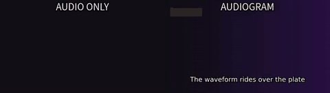

# A podcast episode as an audiogram

[All use cases](README.md) · [日本語の README](../../README.ja.md)

## What you say

> "Take the sound of `talk.mp4` as a podcast episode at podcast loudness. Then make a YouTube video
> of it: the cover image behind a waveform, the title, and the captions from `talk.srt`."

The sound is the talk in [`demos/footage/veo_talk_en.mp4`](../../demos/footage/README.md)
(AI-generated with Google Veo), 7.85 s; the cover is the talk's first slide,
`demos/footage/slide_en_1.png`, and the cues are `veo_talk_en.srt`. Nothing is fetched and no
cover art is made up: the image is a file you give.

## What the agent runs

```bash
python3 scripts/audio.py demos/footage/veo_talk_en.mp4 -o episode.m4a
python3 scripts/loudness.py episode.m4a -I -16 --tp -1.5 -o episode_podcast.m4a
python3 scripts/check.py episode_podcast.m4a --platform podcast
python3 scripts/waveform.py episode_podcast.m4a --image demos/footage/slide_en_1.png --platform youtube --title "Episode 12" --srt demos/footage/veo_talk_en.srt -o audiogram.mp4
python3 scripts/look.py audiogram.mp4 --at 1.5 -o audiogram_frame.png
```

- `audio.py` with an audio extension drops the picture: `episode.m4a` is the sound only.
- `loudness.py -I -16 --tp -1.5` is the podcast level (the video platforms use −14).
- `waveform.py --image` draws the waveform over the still, adds the title and burns the captions,
  at the YouTube frame (1920×1080).

The delivery template does the audiogram, the captions, a title lower-third, −14 LUFS, the
`youtube` export and its check in one command:

```bash
python3 scripts/render.py episode_podcast.m4a --template audiogram --image demos/footage/slide_en_1.png --srt demos/footage/veo_talk_en.srt --title "Episode 12" -o audiogram_template.mp4
```

## What came back

Measured on this footage with 4.17.0 and FFmpeg 6.1.1:

```text
wrote episode.m4a (7.850s, audio aac 2ch 48000Hz, video dropped)
measured: -17.7 LUFS, TP -3.2 dBTP, LRA 1.6 LU
result:   -16.0 LUFS, TP -1.6 dBTP (target -16.0 LUFS, TP <= -1.5)
episode_podcast.m4a — podcast
  PASS channels   2ch  (expected 1 (mono) or 2 (stereo))
  WARN chapters   none  (expected >= 1 chapter marker)
  PASS loudness   -16.0 LUFS  (expected -16 ± 1 LUFS)
  PASS true peak  -1.6 dBTP  (expected <= -1 dBTP (+0.1 dB tolerance))
  7 checks, 0 failed, 2 warnings
--platform youtube: 1920x1080 @ 25fps
wrote audiogram.mp4 (7.840s, 1920x1080, waveform, audiogram)
```

The template run ends with `check: OK for youtube`.

## The result



This is the [audiogram demo](../demos.md#audio-episode-as-a-shareable-audiogram): the same
`waveform.py --image` call on a music track, over a plate made with `background.py`, with a title
and captions. The repository has no clip of this exact run; the commands above make one from the files
it does have.

## What to check

- **The chapters WARN.** Podcast apps show chapter markers as a table of contents. Write them with
  `metadata.py episode_podcast.m4a --chapters chapters.txt` (a `TIME TITLE` per line, streams
  copied), or let `metadata.py --auto-chapters` propose them from pauses and name them `Chapter N`
  for you to rename.
- **The cover on another frame.** `--image-fit cover` (the default) fills the frame by cropping.
  This 16:9 slide on a vertical frame (`--platform reels`) loses its left and right edges, and the
  slide's headline is cut mid-word (tried while writing this page); use `--image-fit contain` or `blur`, or a cover made for that shape, and
  look at a frame before delivering.
- **The captions.** They are burned as written, so check the SRT; `look.py --at` shows one frame.
- **Silence.** `waveform.py --on-silent fail` refuses a track with no measurable sound instead of
  drawing a flat line.
