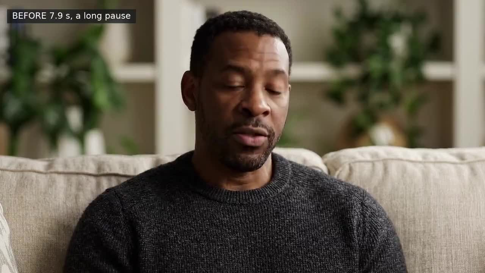
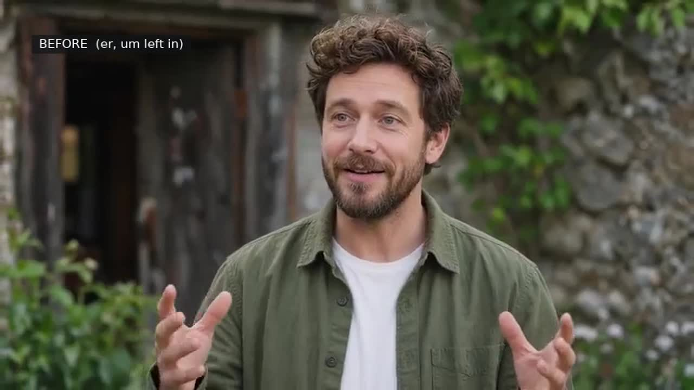

# A cut-down of a long recording

[All use cases](README.md) · [日本語の README](../../README.ja.md)

## What you say

> "This recording has long pauses and a few 'um's. Take the dead air out, keep a little room
> around the speech, and drop the fillers. Show me where you cut before you render."

The footage here is short, because the repository keeps its clips small:
[`demos/footage/veo_pause_en.mp4`](../../demos/footage/README.md) (7.85 s, a man who pauses mid-sentence,
AI-generated with Google Veo) and `ai_talk_en.mp4` (15 s, English speech with two hesitations,
AI-generated, with its word timings in `ai_talk_en.words.json`). The commands are the same for an
hour: the README's [one-hour measurements](../../README.md#a-one-hour-recording) give `silence.py --list`
14 s for a 60-minute file.

## What the agent runs

First a light copy to review on, and the list of what would be cut, before anything is rendered:

```bash
python3 scripts/proxy.py demos/footage/veo_pause_en.mp4 --width 640 -o review.mp4
python3 scripts/silence.py demos/footage/veo_pause_en.mp4 --list
python3 scripts/silence.py demos/footage/veo_pause_en.mp4 --list --threshold -30 --margin 0.12 --min-silence 0.4
```

The first `--list` finds nothing, and says why: the room never drops below the default −35 dBFS.

```text
0 silences, keeping 1 ranges: 7.83s of 7.85s (removing 0.02s)
hint: no passage sits below -35 dBFS for 0.6s; the track's mean level is -22.0 dBFS (peak -3.1). For a quiet-room recording try --threshold -16, or a shorter --min-silence
```

With `--threshold -30` it finds the four pauses. Then the cut, with a time map for re-timing
anything that was placed on the source's clock (subtitles, chapter marks):

```bash
python3 scripts/silence.py demos/footage/veo_pause_en.mp4 --threshold -30 --margin 0.12 --min-silence 0.4 --timemap tight_map.json -o tight.mp4
python3 scripts/look.py tight.mp4 -o tight_sheet.png
```

Fillers are removed only where a speech engine timed them. Here the timings are a file; with a
local engine installed, `--transcribe` makes them instead:

```bash
python3 scripts/silence.py demos/footage/ai_talk_en.mp4 --filler --words demos/footage/ai_talk_en.words.json --margin 0 -o no_fillers.mp4
```

For a recording with distinct shots (a match, an event), `scenes.py --highlights N --edl picks.txt`
proposes ranges and `cut.py --segments` turns the chosen ones into the cut-down (the
[scene detection demo](../demos.md#scene-detection-into-a-highlight-reel) shows both). On a clip that is one
continuous shot, as these are, it proposes the whole clip as one scene.

## What came back

Measured on this footage with 4.17.0 and FFmpeg 6.1.1:

```text
4 silences, keeping 5 ranges: 5.88s of 7.85s (removing 1.97s)
warning: 2 cut point(s) sit within 10 dB of --threshold (3.83s, 7.83s): a breath or a word's weak tail may be cut; listen there, or lower --threshold / raise --margin (--margin-tail for an `out` edge, --margin-lead for an `in` edge)
wrote tight.mp4 (5.875s, expected ~5.875s)
wrote tight_map.json

--filler: 2 filler word(s), 0.62s, from 14 word timings (en, list builtin)
```

`tight_map.json` lists every kept range with its place in the source and in the output, and every
removed range with the output time it collapsed to.

## The result

<a href="../../site/media/showcase_pause.mp4"></a>

The take with the pause, then the same take from `silence.py --threshold -30 --margin 0.12
--min-silence 0.4`: 7.9 s to 5.9 s (click to play, with sound). Built by
[`demos/showcase.py`](../../demos/showcase.py).

<a href="../../site/media/filler_en.mp4"></a>

The fillers: "er" at 1.1 s and "um" at 4.4 s, cut from the first 6 s of `ai_talk_en.mp4` with
the same `--filler --words ... --margin 0` (the `filler_en` demo in
[`demos/build.py`](../../demos/build.py)).

## What to check

- **Listen at the warned cuts.** `silence.py` measures the level at every cut and names the ones
  within 10 dB of the threshold (3.83 s here). Nothing in the tool knows whether a removed span held
  a soft word: the result lists `removed_span_content` under `unverified`.
- **The margin.** `--margin 0.12` keeps 0.12 s of room on each side; a speaker who trails off needs
  more (`--margin-tail`), and `--speech-aware` keeps short breaths inside a sentence.
- **Fillers need timings.** Without `--words` or `--transcribe`, `--filler` refuses rather than
  guessing; `like` and other words that carry meaning are not on the built-in lists.
- **Highlights are a proxy.** `scenes.py --highlights` ranks by loudness (`--rank-by audio`) or
  length, never by content. The agent, or you, looks at the sheet and picks the ranges.
- **A long master needs a longer `--timeout`.** The default is 1800 s per ffmpeg call; the
  one-hour section of the README has the numbers.
