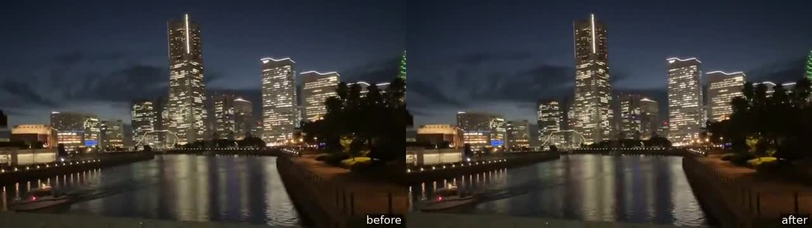
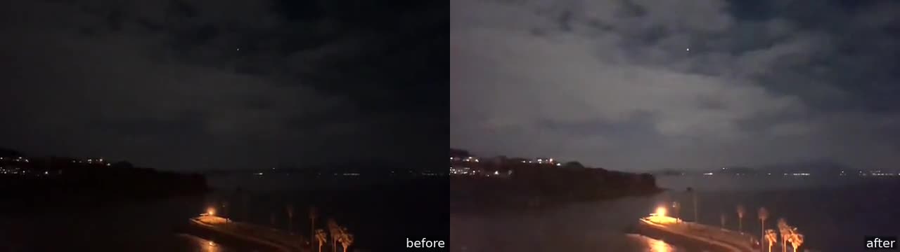

# Cleaning up a phone clip

[All use cases](README.md) · [日本語の README](../../README.ja.md)

## What you say

> "I shot this walking through the city at night and it shakes. Steady it, and bring the sound up
> to a normal level."
>
> "This one is too dark: brighten it and clean the noise the brightening shows."

The two clips are real, shot on a phone by the maintainer, in
[`demos/footage/`](../../demos/footage/README.md): `real_city.mp4` (a city at night, handheld, 4.87 s,
1920×1080, 30 fps, mono sound) and `real_sea.mp4` (a coast at night, 4.83 s, 24 fps).

## What the agent runs

```bash
python3 scripts/probe.py demos/footage/real_city.mp4 --compact
python3 scripts/stabilize.py demos/footage/real_city.mp4 -o steady.mp4
python3 scripts/loudness.py steady.mp4 -o steady_loud.mp4

python3 scripts/color.py demos/footage/real_sea.mp4 --correct --exposure 1.2 --gamma 1.25 -o lifted.mp4
python3 scripts/denoise.py lifted.mp4 --strength high -o clean.mp4
python3 scripts/look.py demos/footage/real_sea.mp4 --at 2 --compare clean.mp4 --compare-at 2 -o compare.png
```

- `probe.py` first: a phone clip is often variable frame rate, HDR or rotated, and every later
  step decides from what it measured.
- `stabilize.py` runs FFmpeg's vid.stab in two passes (measure the shake, then correct it).
- `loudness.py` with no target brings the sound to −14 LUFS and −1 dBTP and copies the picture.
- Brighten first, then denoise: lifting a dark shot lifts its noise, so the noise is cleaned after.

A clip with speech in it gets the voice chain instead of a plain level change:

```bash
python3 scripts/audio.py steady.mp4 --voice light -o steady_voice.mp4
```

## What came back

Measured on this footage with 4.17.0 and FFmpeg 6.1.1:

```text
demos/footage/real_city.mp4: 4.867s | 1920x1080 @ 30.0fps hevc yuv420p | audio aac 1ch 44100Hz
wrote steady.mp4 (4.876s, 1920x1080)
measured: -33.8 LUFS, TP -19.6 dBTP, LRA 0.8 LU
result:   -14.2 LUFS, TP -1.0 dBTP (target -14.0 LUFS, TP <= -1)
wrote lifted.mp4 (4.853s, 1920x1080, bt709/bt709, correct)
wrote clean.mp4 (4.853s, 1920x1080, strength=high)
```

## The result

<a href="../../site/media/showcase_steady.mp4"></a>

<a href="../../site/media/showcase_lowlight.mp4"></a>

Before on the left, after on the right (click to play). Both are built by
[`demos/showcase.py`](../../demos/showcase.py) with the `stabilize.py`, `color.py` and `denoise.py`
calls above. The gallery has the same tools on generated footage:
[stabilise](../demos.md#stabilize-shaky-footage), [denoise](../demos.md#denoise).

## What to check

- **The edges after stabilising.** Taking the shake out moves the frame, and the edge it uncovers
  is filled by stretching the border pixels (`--crop keep`, the default). Look at the edges where
  the shake was worst; `--zoom 5` crops in 5 % to hide them, and `--crop black` shows them as black.
- **Whether the sound should be louder at all.** This clip is street ambience at −33.8 LUFS;
  bringing it to −14 raises its noise by the same 20 dB. For a clip with no speech, a lower target
  (`loudness.py -I -20`) or leaving it alone may be the better call. Below −40 LUFS a clip is
  room tone, and raising it only raises the noise.
- **The grade.** Exposure and gamma are a judgement: the result lists `grade_look` under
  `unverified`. `compare.png` puts the same second before and after side by side.
- **Noise on speech.** There is no showcase clip of a noisy voice, so this page shows `audio.py
  --voice` without a measured result; listen to the result before delivering it.
