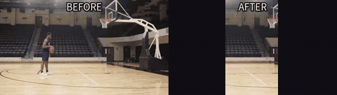

# One master, several platforms

[All use cases](README.md) · [日本語の README](../../README.ja.md)

## What you say

> "Here is the finished talk, `talk.mp4`, with its captions in `talk.srt`. I need it for TikTok,
> Reels, Shorts, YouTube, X, LinkedIn and Facebook, each to that platform's spec. And the master
> at the streaming, EBU R128 and Japanese broadcast loudness."

The master here is [`demos/footage/veo_talk_en.mp4`](../../demos/footage/README.md) (AI-generated
with Google Veo; the speaker does not exist), 7.85 s, 1920×1080, with its cues in
`veo_talk_en.srt`.

## What the agent runs

```bash
python3 scripts/render.py --list-templates
python3 scripts/render.py demos/footage/veo_talk_en.mp4 --template all --srt demos/footage/veo_talk_en.srt -o pack/talk.mp4
```

`--template all` renders the seven video destinations from the same edit, each through its own
shipped template: the frame (9:16 crop, 1:1 crop or 16:9 pad), captions sized and placed for that
platform's safe zone, −14 LUFS, the platform's export preset and a `check.py --platform` on the
file it wrote, with the content checks (black frames, freezes, silence, dropouts). The files land
in the `-o` directory, named after the input, with a `veo_talk_en_pack.md` table of what each one
produced. `--dry-run` on the same command prints every planned command and writes nothing.

The loudness versions of the master are one call; it writes one file per target next to its
input, so the master is copied here first (`--preset copy` is a remux, nothing re-encoded):

```bash
python3 scripts/export.py demos/footage/veo_talk_en.mp4 --preset copy -o master.mp4
python3 scripts/loudness.py master.mp4 --versions streaming,ebu-r128,broadcast-jp
```

One platform at a time, without captions, is an export and a check:

```bash
python3 scripts/export.py demos/footage/veo_talk_en.mp4 --preset reels --fit crop -o talk_reels.mp4
python3 scripts/check.py talk_reels.mp4 --platform reels
```

## What came back

Measured on this footage with 4.17.0 and FFmpeg 6.1.1. The pack table it wrote (this run added
`--fast`, the preview encoder, to save time; a delivery leaves it off):

| platform | file | size | duration | check |
|---|---|---|---|---|
| tiktok | veo_talk_en_tiktok.mp4 | 3.0 MB | 7.85 s | pass |
| reels | veo_talk_en_reels.mp4 | 3.0 MB | 7.85 s | pass |
| shorts | veo_talk_en_shorts.mp4 | 3.0 MB | 7.85 s | pass |
| youtube | veo_talk_en_youtube.mp4 | 2.0 MB | 7.85 s | pass |
| x | veo_talk_en_x.mp4 | 0.6 MB | 7.85 s | pass |
| linkedin | veo_talk_en_linkedin.mp4 | 1.5 MB | 7.85 s | pass |
| facebook | veo_talk_en_facebook.mp4 | 1.4 MB | 7.85 s | pass |

The loudness versions:

```text
result:   -14.1 LUFS, TP -1.0 dBTP (target -14.0 LUFS, TP <= -1)
result:   -23.0 LUFS, TP -7.3 dBTP (target -23.0 LUFS, TP <= -1)
result:   -24.0 LUFS, TP -8.3 dBTP (target -24.0 LUFS, TP <= -1)
```

written as `master_loudnorm_streaming.mp4`, `master_loudnorm_ebu-r128.mp4` and
`master_loudnorm_broadcast-jp.mp4`, each measured after it was written.

## The result


The [TikTok template demo](../demos.md#tiktok-delivery-template): one `render.py --template tiktok`
call on a generated clip, the master on the left and the delivery file on the right. The
repository keeps no clip of the seven-file pack above; the command makes it from the files it
does have.



The [Reels export demo](../demos.md#reels-export-then-checked): `export.py --preset reels --fit
crop`, then `check.py --platform reels`.

## What to check

- **The pack table and each `check`.** A platform whose check fails says `fail` in the table;
  `check.py FILE --platform NAME --content` on that file prints every row with its fix.
- **The vertical crops.** The 9:16 and 1:1 frames are a centred crop of the 16:9 master. Here the
  speaker is in the centre. For a speaker off to one side, `render.py --template NAME --fit blur`
  (or `pad`) keeps the whole frame, or reframe the master first with
  `fit.py --aspect 9:16 --fit crop --crop-x` and render that. `look.py FILE --safe tiktok` shades
  what the app covers.
- **Length limits.** The table of templates (`--list-templates`) gives each platform's maximum
  (90 s for Reels, 140 s for X). Over it, `check.py` reports a WARN marked `basis: guidance`:
  platforms change their limits, and the uploader has the current one.
- **The captions.** Each platform gets its own caption size and position, fitted to the cue; the
  text is burned as written. Look at one frame of each.
- **Loudness versions.** `verified` is true only when every version met its own target; the
  quieter broadcast versions keep their true peak well under the −1 dBTP ceiling.
