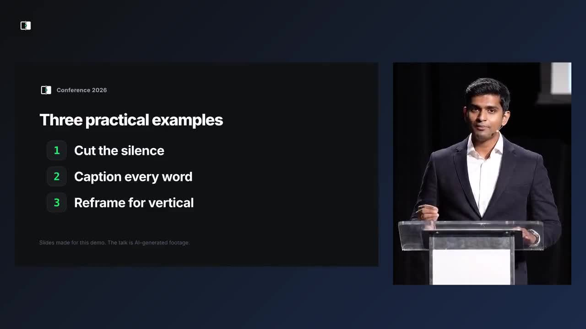
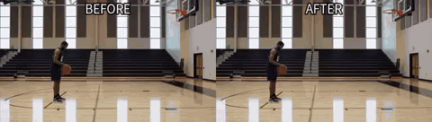

# A talk from two cameras

[All use cases](README.md) · [日本語の README](../../README.ja.md)

## What you say

> "I have the talk from two cameras: a wide shot and a close-up, started at different times. Line
> them up and cut: wide for the first three seconds, close-up until 5.5 s, then wide again."
>
> "And a version with the slides beside him, for the conference site."

The wide shot is [`demos/footage/veo_talk_en.mp4`](../../demos/footage/README.md) (AI-generated
with Google Veo; the speaker does not exist). The repository has no second camera of this talk, so
the first two commands **make one from the wide shot**: a close-up crop that starts 0.6 s late, as
a camera started after the first would. With two real cameras, skip them and pass your own file.

## What the agent runs

```bash
python3 scripts/cut.py demos/footage/veo_talk_en.mp4 --start 0.6 --accurate -o late.mp4
python3 scripts/crop.py late.mp4 --x 490 --y 40 --width 960 --height 540 -o cam_b.mp4

python3 scripts/multicam.py demos/footage/veo_talk_en.mp4 cam_b.mp4 --offsets-only
python3 scripts/multicam.py demos/footage/veo_talk_en.mp4 cam_b.mp4 --switch 0-3:0,3-5.5:1,5.5-7.2:0 --width 1920 --height 1080 --fps 24 -o multicam.mp4
python3 scripts/look.py multicam.mp4 -o multicam_sheet.png
```

- `multicam.py` measures each camera's offset against the first by cross-correlating the sound,
  then cuts on the reference camera's clock: `START-END:CAM`, camera 0 being the first file. The
  sound comes from camera 0 unless `--audio N` says otherwise.
- `--offsets-only` prints the measured offsets and writes nothing, so they can be read before a
  render.
- `--switch energy` cuts to whichever camera is loudest instead of a list. That needs each speaker
  on their own camera's microphone: there is no speaker identification.

The slides beside the speaker (the showcase's conference layout; the slide PNGs are
`demos/footage/slide_en_*.png`):

```bash
python3 scripts/loudness.py demos/footage/veo_talk_en.mp4 --lufs=-14 -o speaker.mp4
python3 scripts/insert.py demos/footage/slide_en_1.png --duration 4.3 --width 1920 --height 1080 --fps 24 -o slide1.mp4
python3 scripts/insert.py demos/footage/slide_en_2.png --duration 3.55 --width 1920 --height 1080 --fps 24 -o slide2.mp4
python3 scripts/join.py slide1.mp4 slide2.mp4 --transition none -o slides.mp4
python3 scripts/fit.py speaker.mp4 --aspect 4:5 --fit crop --width 864 --height 1080 -o speaker_4x5.mp4
python3 scripts/background.py --gradient 0x101114:0x1a2a4a --angle 45 --width 1920 --height 1080 --fps 24 --duration 7.85 -o canvas.mp4
python3 scripts/overlay.py canvas.mp4 --video slides.mp4 --position 48,205 --margin 0 --scale 1192 -o pbp1.mp4
python3 scripts/overlay.py pbp1.mp4 --video speaker_4x5.mp4 --position 1288,205 --margin 0 --scale 584 -o pbp2.mp4
python3 scripts/audio.py pbp2.mp4 --replace speaker.mp4 -o side_by_side.mp4
```

## What came back

Measured on this footage with 4.17.0 and FFmpeg 6.1.1:

```text
wrote late.mp4 (7.250s, expected ~7.250s, re-encoded, frame precision)
wrote cam_b.mp4 (7.253s, 960x540)
demos/footage/veo_talk_en.mp4: +0.000s (confidence 1.00)
cam_b.mp4: +0.600s (confidence 1.00)
wrote multicam.mp4 (7.850s, 4 cuts, audio from input 0)
```

The 0.6 s the second camera was started late is what `multicam.py` measured from the sound alone.
Camera B is 960×540 and is scaled to the 1920×1080 output; a real close-up camera would not lose
that resolution.

## The result

<a href="../../site/media/showcase_talk_en.mp4"></a>

The side-by-side layout (click to play, with sound), built by
[`demos/showcase.py`](../../demos/showcase.py) with the commands above and the logo added with
`overlay.py --image`. The Japanese version is
[`showcase_talk_ja.mp4`](../../site/media/showcase_talk_ja.mp4).



The [multicam demo](../demos.md#two-cameras-one-cut-list): the same `multicam.py --switch` on two
generated cameras whose sound is 0.6 s apart. The repository has no clip of the two-camera talk
above; the commands make it from the files the repository does have.

## What to check

- **The confidence.** Each offset comes with a confidence; below 0.3, or an offset near the edge
  of the analysis window, it is probably wrong: raise `--analyze-seconds`, or find a clap.
- **Drift.** Two devices recording for more than about ten minutes drift apart; `--fix-drift`
  measures and corrects it.
- **Lip sync and the choice of shot.** The sound is one camera's; look and listen at each cut.
  `multicam.py` lists `lip_sync` and `shot_choice` under `unverified`: it measured the offsets, not
  whether the cut looks right.
- **A range a camera does not cover.** Camera B starts 0.6 s late. Asked for camera 1 at 0–1 s,
  `multicam.py` says `camera 1 has not started at reference 0.00s; using camera 0 for that range`
  and cuts to camera 0 there; the `cuts` in its result name the camera each range really used.
