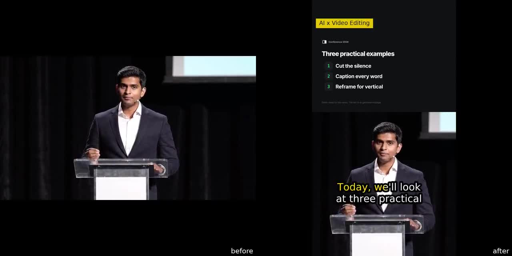

# A vertical short with captions, from a landscape talk

[All use cases](README.md) · [日本語の README](../../README.ja.md)

## What you say

> "Here is `talk.mp4`, one camera on the speaker, and the two slides as PNGs. Make a Reels short:
> the slides on top, him below, the captions from `talk.srt` popping word by word."

The footage is [`demos/footage/veo_talk_en.mp4`](../../demos/footage/README.md) (AI-generated with
Google Veo: the speaker does not exist), 7.85 s, 1920×1080, 24 fps, with its cues in
`veo_talk_en.srt` and the slides in `slide_en_1.png` and `slide_en_2.png`.

## What the agent runs

Every line is one tool. Run from the root of a checkout; an installed skill has the same scripts in
`~/.claude/skills/ffmpeg-skill/scripts/`.

```bash
python3 scripts/probe.py demos/footage/veo_talk_en.mp4 --compact
python3 scripts/loudness.py demos/footage/veo_talk_en.mp4 --lufs=-14 -o speaker.mp4
python3 scripts/insert.py demos/footage/slide_en_1.png --duration 4.3 --width 1920 --height 1080 --fps 24 -o slide1.mp4
python3 scripts/insert.py demos/footage/slide_en_2.png --duration 3.55 --width 1920 --height 1080 --fps 24 -o slide2.mp4
python3 scripts/join.py slide1.mp4 slide2.mp4 --transition none -o slides.mp4
python3 scripts/fit.py speaker.mp4 --aspect 1:1 --fit crop --width 1080 --height 1080 -o speaker_1x1.mp4
python3 scripts/background.py --color 0x101114 --width 1080 --height 1920 --fps 24 --duration 7.85 -o tall.mp4
python3 scripts/overlay.py tall.mp4 --video slides.mp4 --position 0,232 --margin 0 --scale 1080 -o short1.mp4
python3 scripts/overlay.py short1.mp4 --video speaker_1x1.mp4 --position 0,840 --margin 0 --scale 1080 -o short2.mp4
python3 scripts/audio.py short2.mp4 --replace speaker.mp4 -o short3.mp4
python3 scripts/caption.py short3.mp4 --srt demos/footage/veo_talk_en.srt --lang en --animate pop --karaoke --platform reels -o short4.mp4
python3 scripts/graphics.py short4.mp4 --template chapter --title "AI x Video Editing" --lang en --position top-left --platform reels -o short5.mp4
python3 scripts/export.py short5.mp4 --preset reels -o social_short.mp4
python3 scripts/check.py social_short.mp4 --platform reels
python3 scripts/look.py social_short.mp4 --safe reels -o sheet.png
```

Why each step is there:

- `loudness.py` first, so every later file carries a voice at −14 LUFS.
- `overlay.py --video` keeps the main input's sound only (the canvas is silent), so
  `audio.py --replace` puts the voice back.
- `caption.py --platform reels` keeps the cues inside the Reels safe area, clear of the parts of
  the frame the app's own UI covers; the size is fitted to the cue, and the text is burned as
  written.
- `export.py --preset reels` writes the delivery file and corrects the loudness when it is off;
  `check.py` grades it against the Reels row of the delivery table.

When the layout does not matter (one camera, nothing on top), one command does the reframe, the
captions, the loudness, the export and the check:

```bash
python3 scripts/render.py demos/footage/veo_talk_en.mp4 --template reels --srt demos/footage/veo_talk_en.srt -o reels.mp4
```

## What came back

Measured on this footage with 4.17.0 and FFmpeg 6.1.1 (the lines each tool prints):

```text
measured: -17.7 LUFS, TP -3.2 dBTP, LRA 1.6 LU
result:   -14.1 LUFS, TP -1.0 dBTP (target -14.0 LUFS, TP <= -1)
wrote slides.mp4 (7.833s, expected ~7.833s, 1920x1080 @ 24fps, 2 clips, none)
cues: 2 wrapped, 2 split, 1 extended
wrote short4.mp4 (7.850s)
wrote social_short.mp4 (7.850s, 1080x1920, h264)
  PASS resolution    1080x1920  (expected short side >= 1080)
  PASS fps           30  (expected <= 60)
  WARN subtitles     none  (expected >= 1 language-tagged subtitle track)
  PASS loudness      -14.1 LUFS  (expected -14 ± 2 LUFS)
  PASS true peak     -1.0 dBTP  (expected <= -1 dBTP (+0.1 dB tolerance))
  13 checks, 0 failed, 1 warnings
```

## The result

<a href="../../site/media/showcase_short_en.mp4"></a>

The source and the short side by side (click to play, with sound). This clip is built by
[`demos/showcase.py`](../../demos/showcase.py) with the commands above, plus `grid.py` to put the
two side by side; [the showcase notes](../showcase.md) list them all. There is a Japanese version
of the same short ([`showcase_short_ja.mp4`](../../site/media/showcase_short_ja.mp4)), made with
`veo_talk_ja.srt` and `--lang ja`.

## What to check

- **The contact sheet.** `sheet.png` shades the parts of the frame the Reels app covers. The
  captions and the title chip must sit outside the shading; `look.py` only draws the picture, so
  this is a look, by you or by an agent that can see images.
- **The words.** `caption.py` reports `caption text unchanged` when it burned the cues exactly as
  given. A word that is wrong in the SRT is wrong in the short.
- **The frame rate.** The Reels preset writes 30 fps (`check.py`: `fps 30`); a 24 fps source gets
  repeated frames. If that matters, export with another preset and check the result.
- **The subtitles WARN.** It says there is no soft subtitle track, which Reels does not need for
  burned captions. `caption.py --mode mux` adds one when a platform asks for it.
- **The crop.** `fit.py --fit crop` keeps a fixed window, centred unless `--crop-x` says otherwise.
  Nothing follows the speaker: a speaker who walks out of the window needs a cut and a second crop.
